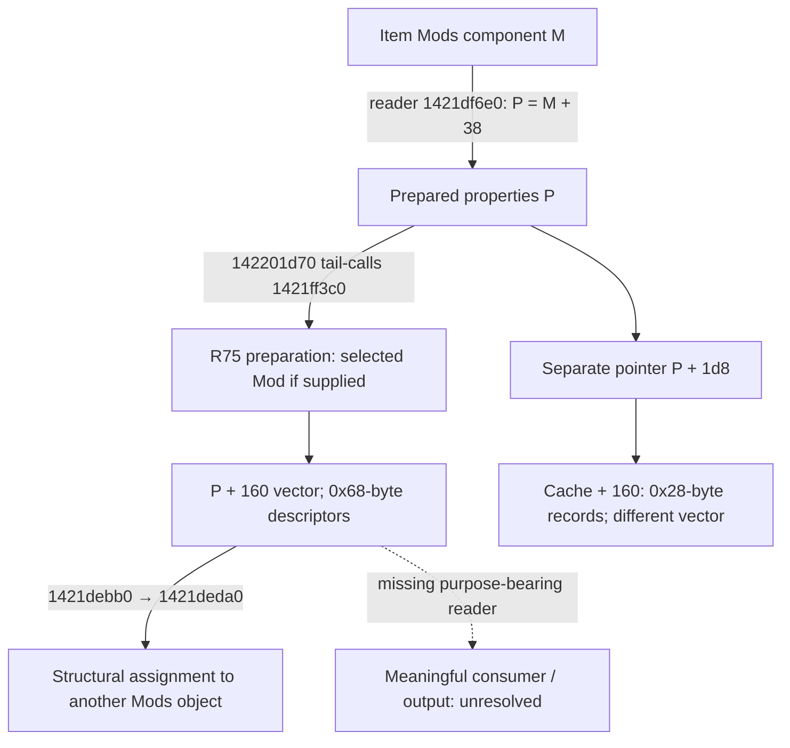

# Mod-derived Buff descriptors: consumer research workbench

## Objective and current state

Follow one prepared Mod-derived Buff descriptor to an actual reader and explain
the reader's output. Begin with Mod row 7300
`ChaosDegenerationAuraPlayersUniqueBodyStr3`, BuffTemplates row 130 and its
foreign-key-linked `unique_deaths_oath_aura` definition. Rows are zero-based
extracted ordinals for the pinned 3.29.3b artifact.

This is the next bounded research batch under issue #370. **N0 is complete;
N1 has owner/storage and structural-transfer evidence, but no reader with an
identified purpose. N2 remains open.** The numerical receiver, target eligibility
and rate-publication connection remain unknown. Keep PR #466 Draft.

## Base and inherited evidence

This branch starts from main `d377bd256036242d2fb43f53eb7110b4897e1862`.
PR #371 is still open at setup time; its documentation is an explicit dependency,
not an implementation dependency or a stack of changes imported into this PR.
Reuse its fixed head `801358d732adbc558d657d8773e273a02bc891b1`:

- [Prepared descriptor evidence](https://github.com/LocalExile/LocalExile/blob/801358d732adbc558d657d8773e273a02bc891b1/Agents/docs/re/client-mod-buff-descriptors.md).
- [First Hit/DoT baseline](https://github.com/LocalExile/LocalExile/blob/801358d732adbc558d657d8773e273a02bc891b1/Agents/docs/re/client-damage-baseline.md).
- [Original-byte and support identities](https://github.com/LocalExile/LocalExile/blob/801358d732adbc558d657d8773e273a02bc891b1/Agents/docs/re/client-damage-evidence.json).

The inherited executable SHA256 is
`78a0e227189c263658a7f65a02f086428b859bfc114ae8e7ce8aab721ebd48d5`;
addresses use preferred image base `0x140000000`. Recheck identities before new
byte claims. Unsealed earlier navigation is a lead, not an accepted finding.

| Existing boundary | Established starting fact | Next question |
|---|---|---|
| Mod/template association | Actual foreign rows link the selected Mod, template and Buff definition | Do not infer recipient or gameplay semantics from the names |
| Descriptor preparation | `0x1421ff3c0` calls the selected prefix of `0x1421ff8f0`; defaults are copied and matching Mod values overwrite slots | Who reads this same descriptor after preparation? |
| Distinct storage | `0x68`-byte descriptors in destination vector `+0x160/+0x168/+0x170`; ordinary aggregate is separate at `+0x140` | Prove object provenance; matching offsets in another structure are insufficient |
| Numerical boundary | The inherited prefix stops at `0x1421fff44`; selected supplied Mod input produces descriptor value `27000/min` | This is not yet target effective damage, a gameplay Buff or a snapshot-time result |
| Separate downstream contract | Received final rates can reach local Life integration | Do not invent an edge from this descriptor to that rate |

## Owner and transfer findings

Original bytes bind two embeddings of the prepared structure. For the selected
item Mod, use the **Mods component's `+0x38` embedding**, not the entity
ObjectMagicProperties component's `+0xc8` embedding. The component names and
vtables are independently indexed in [components](components.md); the new
[focused byte index](client-buff-descriptor-owner-evidence.json) checks their
actual constructor/reader/assignment links against the pinned executable.

All diagram offsets are hexadecimal. Solid edges describe conditional static
code paths, not a recorded Death's Oath activation. The selected Mod/template
mapping and `27000/min` preparation remain inherited R75 evidence.

| Relation | Original anchors | What is established |
|---|---|---|
| Item embedding | `0x1421df1d0/1d4`, `0x1421fec57/5e/65` | Mods constructor initializes `P = M + 0x38`; descriptor vector is at `M + 0x198/+0x1a0/+0x1a8` |
| Item reader to preparation | `0x1421df9a0/9a7`, `0x1422024bf/4dc` | Same `P` enters the base reader and reaches the preparation tail-call after successful parsing |
| Entity embedding, separate owner | `0x141e7762b/658`, `0x141e779b8/9bf` | ObjectMagicProperties uses `P = E + 0xc8`; its descriptor vector would be at `E + 0x228/+0x230/+0x238` |
| Item structural transfer | `0x1421dec21/25/29`, `0x1421defb5/bc`, `0x1421deff0` | The actual Mods assignment slot passes source/destination `+0x38`; the prepared-object assignment dispatches its `+0x160` vector to the `0x68`-record assignment helper |
| Assignment loop | `0x1421e20d0/d3/d6/df/e3` | Existing destination/source elements are passed to `0x1421e23d0` and advanced by `0x68`; this is a transfer, not an identified gameplay/configuration output |
| Misleading cache candidate | `0x14220469f/6b5/6bc`, `0x142203bdd/be4/beb/c91` | The getter first dereferences `P + 0x1d8`, then reads another object's `+0x160/+0x168`; its count uses `0x28`, not `0x68` |

The byte index retains 11 PE-unwind function identities, 56 selected instruction
anchors and three exact vtable slots. Five retained R76 function records were
also compared with fresh decoding and original range hashes. This verifies the
locations and conditional structural paths; it does not execute an item, prove
arbitrary intervening calls preserve state, or classify a meaningful consumer.

### Bounded investigation and next evidence

Investigation A started at the prepared vector and followed the selected owner
methods, exact descriptor lifetime-helper references and typed initialization
callers. It established the embeddings and assignment path above. A bounded
direct-caller query of `0x1421ff1b0` covered 229 sites in 161 unwind owners;
an embedded-offset/stride prefilter and the earlier R76 navigation were used
only to propose candidates. Offset/stride matches were not accepted as types.
These are search coverage, not discovered consumers or new damage formulas.

Stop expanding these offset inventories. The `0x142204680` route is excluded
from this descriptor path by positive pointer provenance. Copy, move and
cleanup routes remain structural evidence only. The unbound `0x1423f5ef0`
getter is not promoted to a descriptor reader because its object type is unknown.

The next admissible investigation needs a concrete escape or non-lifetime read
of **this** vector: for example, an original caller carrying `P + 0x160` into a
reader, or independently retained typed evidence identifying an indirect reader.
Then follow that one reader to its actual output. Do not infer no consumer,
server ownership or presentation-only behavior from unsuccessful searches.

Two bounded getter-provenance investigations did not bind a descriptor escape;
that route is closed until new typed evidence appears. One getter's inspected
bindings use a separately initialized state pointer. The other returns an
unresolved resource-owned row; its identity is insufficient to classify it as
this prepared object. Neither result establishes a meaningful descriptor consumer.

A final coverage repair checked previously omitted `rbp` operands within the
same 161 retained ensure-call owners. Six candidate functions contained 29
matching operands. Their prologues establish `rbp` as a stack-frame base, with
no subsequent business-object reassignment in the decoded functions. Those
operand matches therefore do not establish prepared-object fields. This does
not exclude descriptor-related stack temporaries or other consumers. Stop this
finite query as well; do not replace the missing typed escape with another
global offset, stride or getter inventory. **N1/N2 remain evidence-blocked and
the PR remains Draft.**

## Claim audit at this boundary

| Claim | State |
|---|---|
| Prepared-object embeddings and selected structural assignment | Supported by the focused original-byte index |
| The cache getter reads these prepared descriptors | Rejected for this candidate: the intermediate object and stride differ |
| A meaningful reader/output for the selected descriptor | Unresolved; copying and cleanup do not satisfy N1/N2 |
| `27000/min` is actual target damage, or client DoT publication is recovered | Not established; original R2/R3/R4 remain Partial |
| N0–N3 pass and PR #466 is Ready | Not established; keep Draft |

## Delivery gates

| Gate | Required result | State |
|---|---|---|
| N0: fix the slice | Selected row, precise missing connection, fixed prior evidence and scope exclusions | Complete: this workbench and the Draft PR; no new numerical findings |
| N1: bind a reader | One original-byte field/call path from the prepared descriptor to an identified reader, with owner/object provenance | Partial: embeddings and structural assignment bound; purpose-bearing reader unresolved |
| N2: explain its output | A conditional input → operation → output contract for that actual reader; identify numerical versus configuration/dependency/presentation use through positive output evidence | Pending |
| N3: independent reviewable delivery | One small diagram, field/value-flow table, focused evidence index, remaining gaps and claim audit; latest-main/exact-head and appropriate documentation/tool checks | Pending |

Ready requires N0–N3 for **one actual consumer path**. A positively bound
configuration/dependency/presentation consumer can satisfy consumer classification,
but it does not close actual DoT numerical publication or prove that other
consumers do not exist. The diagram and conclusion must preserve that distinction.
Original R2/R3/R4 stay Partial unless separate evidence justifies a specific change;
this batch does not require or authorize completing all of them.

If N1 or N2 cannot be established, keep Draft and report the exact missing edge.
A search failure, field-copy inventory or same-offset getter is not a passing gate.

## Work-selection and stop rules

1. Work on the first unfinished gate with one active missing connection. Before
   investigating, record the start, expected evidence and stopping boundary.
2. Trace the same descriptor's storage/copy/reader with concrete object identity.
   Prioritize a numerical recipient, Stat/provider or contribution token if the
   actual path exposes one; do not assume one exists in the client.
3. After two bounded investigations fail to advance the same missing edge,
   stop that route. Record facts, inspected coverage and next required evidence.
   If a mandatory gate remains unmet, report it as blocked rather than relabeling
   failed searches as proof of absence or server ownership.
4. Once a path is positively classified as configuration, dependency collection
   or presentation, record its actual output and stop that branch. Do not expand
   into resource packages, rendering or unrelated container internals.
5. Use another Mod only as a minimal control necessary to distinguish the selected
   path. Do not reopen the seven-row preparation catalogue or whole parent-table scan.
6. Add directed numerical comparisons only for newly established arithmetic.
   Reused verification counts and copying/dependency handling are not new formulas.
7. Protect sealed scripts, reports and snapshots. Do not rerun sealed producer
   mains; reference prior identities and their disclosed fixtures. Keep tool and
   evidence memory bounded; use one-shot interpreters, not resident `python -i`.
8. Share through the existing owned research ledger; inspect the projectile
   ledger read-only before a potential overlap. No routine cross-thread messages
   or duplicate Actor/projectile/World/protocol-ingress research.
9. After N0–N3 and final publication checks pass, mark this PR Ready and stop.
   Do not automatically merge, close issue #370 or begin another batch.

## Exclusions

Research/documentation only: no server mechanic changes, client launch/attach/UI,
new capture, CI/deployment, shared REA/Ghidra mutation, peer-file edits or new
subagents. No global Mod/unique/passive/Buff/aura catalogue; no ignite arbitration,
poison aggregation, shared DoT cap, generic time warp, accepted-Hit numerical
application or other special-mechanic expansion. Reuse #371's established
formulas and receiving/integration contracts instead of rederiving them.

Publish only repository-relative references or fixed public source links;
omit machine-specific paths/usernames. Keep target binaries, extracted data,
full decompiler output and private evidence out of Git. Synchronize the relevant
Status/Roadmap and issue #370 when actual findings change, with evidence classes
and unresolved links intact.
