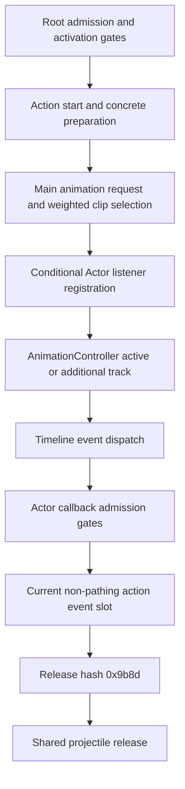

# Animation requests, selection and projectile release (3.29.3b)

> Frozen detailed reference from R81. Historical next-step language is provenance, not an active backlog.
> Current scope and unresolved obligations are in [the delivery matrix](delivery-matrix.md) and
> [verification and limitations](verification-and-limitations.md).

Part of [RE 012](../012-projectile-execution.md).
All findings here are bounded static evidence in the [pinned executable](evidence-and-open-questions.md).
This closes a forward execution route, not an observed successful launch for every skill, owner or network mode.

## 1. From an admitted action to a release event

The [root admission chain](actions-and-emission.md#11-root-creation-local-echo-suppression-and-release-events-are-different-gates)
can reach action start `0x14193d870`.
Its entry still has action/model/resource gates; entering start is not proof that preparation or animation succeeds.
Checked common, spell and bow preparation paths build requests for Actor helpers
`0x141e9a3c0` or `0x141e9bb80`, both taking `RCX=Actor*`, `RDX=request*`.



This is not a claim of an unconditional sequence or that all request routes install the same listener.
The positive registration below is inside `0x141e9a3c0`; the alternate helper's complete registration lifetime
has not been independently reconstructed.

## 2. Main request inputs and their independent RNG

The checked request constructors write:

```text
request.seed8 = u32(zeroExtend16(action.sequence11a) + action.outerRemaining2d0)
```

Neither owner ID, derived byte nor result stage enters this field.
Request `+0` is the common resource selector/default `0xb3` or a prefix-specific selector;
`+4` receives action slot `+0x318` (bow uses `+0x7b0`), and `+0xc` receives `0x14193ef30`'s result.
Do not identify these fields as hashes just from their integer representation.

| Main builder | Normal helper return address | Alternate helper return address |
|---|---|---|
| common `0x141ba2e60` | `0x141ba31a3` | `0x141ba319c` |
| spell `0x1419eea60` | `0x1419eebc3` | `0x1419eebad` |
| bow `0x141b6f100`, two branches | `0x141b6f273`, `0x141b6f33f` | no direct call in this checked body |

These exact callers matter to capture filtering.
Normal helper `0x141e9a3c0` also creates attached requests that call the alternate helper at
`0x141e9a8a7` and `0x141e9a949`; an enclosing root scope alone does not make them main requests.
Delayed/repeated preparation has a separate normal-helper return address `0x141ba48ec`.
It is excluded from the root-primary observation whitelist.

The normal helper ordinarily calls `0x141e999e0`, which selects `0x141e991e0` or `0x141e98c40`.
A configuration `+0xa` branch can instead reach `0x141e99bd0` directly, subject to its floating-point gates.
The alternate helper also reaches `0x141e999e0`.
All three selectors consume the request seed:

| Selector | Request seed read | Zero fallback read | Local initializer call |
|---|---|---|---|
| `0x141e98c40` | `0x141e98cd1` | `0x141e98cd9` | `0x141e98ce8` |
| `0x141e991e0` | `0x141e99270` | `0x141e99277` | `0x141e9928b` |
| `0x141e99bd0` | `0x141e99c6c` | `0x141e99c74` | `0x141e99c84` |

A zero request seed falls back to Actor `+0x21c:u16`.
The effective u32 seeds a selector-local stack state through scalar initializer `0x140e0bec0`.
It is separate from batch variance, TS terminal children and TLS state.
Eligible `0x58`-stride candidates carry a weight at `+8`.
The selectors accumulate weights and use `0x140484fa0` bounded samples to replace the current selection
when the draw is less than the current weight; a cumulative-u32-zero branch uses raw draw `0x140484ed0`.
This is not `seed % clipCount`.
The normal-request prefix in section 3.4 executes both ordinary selectors and their eligibility for supplied
resources/providers. The configuration-specific third selector, actual authored inputs and wider admission
remain separate. The earlier prepared-spec startup in section 3.3 did not execute these whole selectors.

## 3. Listener registration and the timeline dispatcher

Actor construction installs table `0x1435aa508` at its embedded interface `Actor+0x160`.
Do not confuse it with the different interface at `+0x158`.
In normal animation request `0x141e9a3c0`, the component lookup names `AnimationController` explicitly.
For a selected entry whose byte `+0x30` is nonzero, `0x141e9b5cb..0x141e9b617` creates a handle containing
`{Actor+0x160, controller+0x18}` and appends it to that controller's listener container.
The Actor retains subscription handles at `+0x4f8/+0x500/+0x508`.
Another component registration later in the same function is a different listener.

AnimationController constructor `0x141dba060` installs main table `0x143596598` at `0x141dba0c6`.
Its virtual `+0x10` is `0x141dbbe70`, spanning more than one unwind fragment.
It advances the active track at controller `+0x180` and additional tracks from `+0x1e0` through
`0x141dbc010(track, controller, float delta)`.
The timeline updates progress/event indices and calls `0x141dbcd70(context,event)`.
Context `+0` is the descriptor, `+8` the controller and `+0x10` a current-ordinal pointer.
After dispatch the timeline checks whether its progress/ordinal changed before consuming more delta.
This does not establish a fixed 30 Hz release cadence or the complete outer component scheduler.

Dispatcher `0x141dbcd70` selects listener thunk `0x140cea05c` when descriptor DWORD `+0x4c` is zero,
and `0x140cea0a8` otherwise.
They jump to listener virtual `+0x48` or `+0x50`, respectively.
Event type 15 follows a script path that skips this ordinary listener dispatch.

| Windows x64 argument | Object at Actor listener entry |
|---|---|
| RCX | listener = Actor `+0x160` |
| RDX | AnimationController |
| R8 | animation descriptor |
| R9 | timeline event |

### 3.1 Joining active-track advancement to actual release events

**S:** original controller update `0x141dbbe70`, full timeline `0x141dbc010` and the next-event leaf
`0x141dbbe00` now compose with the original dispatcher/Actor/release chain described below. The installed
controller table `0x143596598 + 0x10` is read from the pinned PE. Six supplied skill/equipment witnesses cover
both normal and alternate resource channels. The event pointer and dispatch time are selected by the native
timeline, replacing the earlier directly supplied event-dispatch call. Clip selection, track initialization and
the actual asset event arrays remain explicit inputs; the fixture's timestamps are not measured skill timings.

The tested active track is embedded at controller `+0x180`. Controller ordinal `+0x190 == -1` skips that
track entirely. A negative controller `+0x228` excludes its separate catch-up preparation, and the additional
track tree is empty in these controls. Track fields used by the original ordinary-event path are:

| Track offset | Recovered use in this path |
|---|---|
| `+0` | resource holding per-ordinal event-pointer vectors at resource `+0x10` |
| `+0x10` | current ordinal selecting one `0x18`-byte vector record |
| `+0x24` | current animation progress |
| `+0x28` | event-pointer index in that vector |
| `+0x2c` | next event/end boundary |
| `+0x30` | rate multiplied by controller float `+0x1f8` |
| `+0x38/+0x3c` | endpoints whose difference supplies the duration limit |
| `+0x40` | raw elapsed accumulation, incremented by incoming delta before rate gating |

For tested nonnegative finite rates, the timeline computes the rate product in binary32 and caps
`progress + rate * remainingDelta` at the duration. If the next boundary is greater than that limit it advances
progress to the limit and returns. Otherwise, when the event index is below the vector length, it first moves
progress to the boundary and then dispatches the indexed event through `0x141dbcd70`.
Equality permits dispatch: two distinct records at the same timestamp can both fire with zero remaining delta.
One longer update can therefore emit multiple batches; this is not one release per World update or projectile tick.

The generated context contains `{track, controller, &localOrdinalSnapshot}`. The third pointer is a mutable
local u32 copy, **not an alias of track `+0x10`**. After dispatch the original caller reloads that track ordinal
and progress. Only if the ordinal equals the possibly modified local copy and progress still equals the saved
event boundary does it call the next-event leaf. A changed event index alone is not tested by this guard.
Explicit callback controls exercise ordinal invalidation, progress seek/pause, index-only mutation and local-copy
mutation; they are not identified official subscribers or APIs. Normal calls then subtract the consumed
animation distance divided by the rate from remaining delta, and may continue while it is nonnegative and
the track ordinal is not `-1`.

The next-event leaf advances the current index, or resets it to zero when its incoming index equals the vector
length. It reads event float `+0xc` for the new boundary. A next timestamp beyond the duration instead selects
the end index and duration boundary. The controls stop before executing the resulting clip-completion branch;
the reset rule is not a claim that every completed animation loops.

Zero rate, including negative zero, leaves animation progress unchanged while raw elapsed still accumulates.
The original `0x1401c6f10` predicate also rejects the tested positive/negative infinite products. Its masked
COMISS/SETAE rule returns false for the tested quiet NaN; it must not be replaced by an inferred general
`!isfinite` test. A full NaN/negative-rate/exceptional floating-point timeline is outside the finite controls.
The new BT interpreter operation has separate checks at original site `0x141dbc1c4`, including register bit-index
masking; the supplied ordinary-track bit is unset in the integrated membership control.

Events rejected by the descriptor filter or Actor event-type gate still advance the timeline when callbacks
leave its compared state unchanged. Other event hashes/scripts, marked-track completion/transition, additional
tracks, catch-up preparation and the optional track `+0x50` rendering-provider path are not executed here.
In particular the latter path contains separate TLS access; omitting it is not evidence that timeline execution
has no indirect RNG/TLS effects.

Two controls join independent result/control bytes through the actual wire pump and World core before the
timeline. The component callback explicitly calls the native controller update, replacing R62's direct event
injection at that boundary. Raw zero still applies the results before the component callback; nonzero mode
applies the selected stamps around the native-timeline-generated release. **Native Actor runner, root startup
and animation subscription are not executed by this component callback.** ProcessResult numerical effects,
actual outer scheduling, selected resources/model/terrain/stat inputs and official timing remain separate.

Ignored round63 `audit_timeline_release.py`, `timeline-release-audit.asm/json`, `check_timeline_release.py` and
`timeline-release-controls.json` retain fresh PE identities and finite original-instruction execution. Counts
are 196 ranges / 14113 decoded sites / one controller slot / 16 anchors, with 46 controls executing 639976
original-instruction steps / 4446 visited sites. Publication identity is retained with the ignored local evidence.

### 3.2 Native Animated updates and model component membership

**S:** one established ordinary World-to-controller connection passes through **Animated**. This path does
not use Actor's runner to invoke the controller. These objects have different virtual interfaces; equal slot
offsets do not imply equal roles.

```text
World core -> object component +0x40
  -> Animated 1435a5030/+40 -> 141e54d10
     -> Animated+260 model entity
        -> model [+1f0,+1f8) component pointers
           -> component +10 -> AnimationController 141dbbe70
              -> active track/timeline -> Actor listener -> current action release
```

Animated constructor `0x141e55180` installs `0x1435a5030` at `0x141e551dd..0x141e551e4`.
Its ordinary update `0x141e54d10` performs separate pending-model/direction work before reaching
`0x141e55034`. With borrowed-model field `Animated+0x1b8` null, it optionally updates attachments, increments
depth `+0x180`, reads model `+0x260` and caches the model update-vector begin/end. Each pointer receives
the original binary32 delta through virtual `+0x10` at `0x141e55089`. Empty/null models still pass through
guard cleanup `0x141e5b0f0`, which decrements the depth. A preexisting nesting depth is restored, not reset.
The cleanup can apply a pending model replacement at depth zero; the finite controls leave that request empty.

Model construction `0x141da6360` initializes this vector with four inline pointer slots and calls
`0x141da6740`. That body first initializes **all** supplied model components through virtual `+0x8`.
A second traversal asks each component's `+0x30` predicate and appends true members to the update vector
in component order. It separately asks `+0x38`, `+0x40` and `+0x48` for callable pointers, populating three
different lists at model `+0x228`, `+0x280` and `+0x2b8` when nonnull. Those slots are not ordinary World
component updates. The builder finally transfers metadata bytes `+0x298/+0x299` into model flag masks `0x4/0x8`,
preserving the other bits. Storage growth, authored component selection and later mutation remain boundaries.

The actual AnimationController table `0x143596598` binds `+0x30` to `0x140125860` (`AL=1; ret`),
`+0x10` to `0x141dbbe70`, and all three callable getters to `0x1400ecd70` (null). This positively establishes
its membership and ordinary update route. Its initialization slot `+0x8 -> 0x141dbbc90` is also executed,
with explicit metadata DWORD `+0x1e0 == -1` to skip default-clip startup. Other initialization branches include
clip construction and a conditional TLS draw; their absence in these controls is not global RNG absence.
The independently supplied active track, event resources and Actor subscription from section 3.1 remain inputs.

Actor initialization `0x141e8cd70` separately obtains the dependency component by metadata index, reads that
component's `+0x260` into Actor `+0x198`, then calls the named AnimationController lookup `0x14013def0`
and stores it at Actor `+0x1a0`. This static identity chain does not make Actor the timeline updater.
The ordinary composition still leaves Actor's separate `+0x40` runner as an observing boundary.

Animated's secondary World slot `+0x48 -> 0x141e550d0 -> 0x141e550e0` is different: after its own guard,
it iterates model `+0x228..+0x230` **16-byte `{object, callable}` records**, passing the object and delta
to the callable. It does not repeat the ordinary update-pointer traversal. No controller membership in that
secondary list is inferred from a shared slot number; the checked controller getter is null.

The round64 finite composition runs the real membership builder and Animated ordinary update through all
six release witnesses and both event channels. Wire/core controls use two real owner components: an explicitly
observed Actor runner and the real Animated binding. The latter receives the core's component prefix `0x1000`
and produces the timeline event without R63's direct component-to-controller callback. In raw-zero mode the
selected results are still applied before release; nonzero mode applies them around release using stamps
`0x1001/0x1002`. These are supplied control records, not official packet timing.

Ignored round64 `audit_animated_release.py`, `animated-release-audit.asm/json`, `check_animated_release.py`
and `animated-release-controls.json` retain the original-byte identities and finite controls. Loaded model
assets/metadata, initialized track/listener, stable vectors, other providers, pending/borrowed-model paths,
native Actor/root startup, full outer scheduling and numerical ProcessResult remain separate. This closes
one real scheduling connection without claiming a complete native frame or full rendering reconstruction.

### 3.3 Prepared animation inputs, first-main-track production and subscription insertion

**S:** the actual normal request calls `0x141dbb620(controller, preparedSpec)` at `0x141e9b514`.
Original-byte controls now execute that callee through track construction `0x141dbb280`, transfer leaf
`0x141dbaf90`, first next-event selection and start notification `0x141dd3420`. They then execute an
explicitly entered original registration region before the native Animated/timeline/release chain.
This replaces the earlier initialized-track and direct-listener fixtures. Selected resources, the prepared
specification and matching model/controller relation are still supplied; the entire normal request, root
startup and selector eligibility are **not** executed by this composition.

The callee rejects a null resource or an unsigned selected ordinal outside the sum of three resource lists:
metadata `+0x40/+0x48` records of `0x108` bytes, resource `+0x78/+0x80` records of `0x130` bytes, and
resource `+0x90/+0x98` alias records of `0x40` bytes. Metadata is obtained through the loaded handle's
`+0x28`. Ordinary first-main startup requires spec DWORD `+0x34 == 0` and controller `+0x190 == -1`.
Additional tracks and replacement of an active main track have other branches, not silently supplied success.

| Prepared-spec field | Produced main-track state |
|---|---|
| `+0/+8` resource and reference handle | track `+0/+8`; construction increments the new handle, transfer releases the old handle and moves the temporary ownership |
| `+0x10` selected ordinal | resolved track `+0x10`; alias identity is separately retained at `+0x20` |
| `+0x14/+0x18/+0x1c` | copied to the corresponding track fields |
| `+0x20` rate | track `+0x30`; finite nonnegative values survive, negative/NaN/infinity becomes `1.0`; zero remains zero |
| `+0x28` | copied to track `+0x34`, not the rate |
| `+0x2c/+0x30` normalized endpoints | start progress uses the lower endpoint; the upper endpoint is selected by the original pointer-returning clamp helper |
| `+0x34/+0x59` | track `+0x4c/+0x51`; the zero main-track selector also determines the ordinary event channel |

For a base `0x108` record, duration is binary32 `u32(record+0x20) / 1000`.
The constructor writes track begin `+0x38 = 0`, progress `+0x24 = duration * lowerEndpoint`, and end
`+0x3c = duration * selectedUpperEndpoint`. A derived `0x130` record instead obtains its begin offset from
`u32(record+0x10c) / 1000`, adding that offset to the end but **not** to the initial progress expression.
The event index is first set to the selected vector's length; the real next-event leaf resets/selects its first
boundary. Incoming elapsed `+0x40` starts at zero. Controller counter `+0x178` increments, skips zero after
wrap, and becomes track stamp `+0x48`; this stamp is distinct from the selected ordinal.

Before main installation, `0x14015d310 -> 0x141dbd250` clears the pending `0x18`-byte configuration records
at controller `+0x200/+0x208`, decrementing their nonnull reference handles and retaining the allocation.
After installation, optional metadata/provider notifications and start-listener delivery remain separate from
the later release event. The controls use empty metadata notification lists and a null optional provider;
they do not describe those unexecuted callbacks as no-ops.

Alias resolution introduces another random context. A nonzero alias byte `+0x38` reads its first ordinal
directly. Otherwise its `{ordinal:u32, weight:u32}` list accumulates wrapping u32 weight. Zero weights are
skipped. A cumulative weight below two selects draw zero without RNG; other weights request the bit width
of `total-1` from **TLS** helper `0x140e3b310`, reject samples `>= total`, and replace the current ordinal
when the accepted sample is below the current weight. This is separate from the request-seeded selectors
in section 2. Six explicit TLS seeds, including a rejected sample, independently match the LCG/rejection expression.
An all-zero list does not choose its first entry: a bounded constructor-prefix control retains the unresolved
ordinal. It stops before the subsequent invalid base-lookup diagnostic, not an invented successful fallback.

The subscription control enters `0x141e9b5c1` with an explicit selected entry and controller. Byte `entry+0x30`
gates allocation of the real 16-byte `{Actor+0x160, controller+0x18}` handle. Original instructions append it
to the controller's **indirect** listener vector and transfer the same handle into Actor `+0x4f8/+0x500`.
This control stops at `0x141e9b693`, before the distinct Animated listener registration. Disabled registration
does not allocate; allocation failure can append a null Actor handle but no controller listener. Storage has
explicit spare capacity, so vector growth and full subscription removal remain outside these controls.

Six ordinary-channel witnesses create their own main tracks and subscription handles, then produce two
actual release batches each. Two wire/core controls retain the established mode-dependent checkpoint order.
They still supply authored event arrays/timestamps, loaded handles/metadata, selected spec/model relation,
allocator/storage and inherited equipment/terrain/provider boundaries. They do not establish a complete
normal-request run, default-clip startup, additional-track channel, Actor runner, actual TLS lifetime,
official cadence or numerical damage.

### 3.4 Native ordinary request selection and prepared-spec production

The later finite composition starts at **`0x141e9a3c0`**, rather than supplying its selected index or prepared
spec. It stops at `0x141e9b519`, after the original first-main-track call returns, before model matching and
the later subscription work. Its successful route is:

```text
normal request entry
 -> optional Actor selector remap
 -> 141e98580 -> 141e98030 -> 141e98630 candidate lookup and Actor cache publication
 -> supplied catalog row: enabled, configuration +0xa = 0
 -> 141e999e0 -> 141e98c40 or 141e991e0
 -> 141da6050 embedded loaded resource, 141db3790 resource-ID mapping
 -> native request-local spec construction/copy
 -> 141dbb620 -> first main track
```

The supplied model-metadata handle exposes the actual signed-key candidate lookup at `0x141e98630`.
Its native wrappers select/publish Actor `+0x520/+0x530` state. These controls disclose a fresh ordinary
cache, null overlay, no stance transition, no additional candidate track, empty extra-track tree and no
optional notification provider. They execute the real missing-extra-track stop helper `0x141dbb040`;
that operation is not replaced with a no-op. Actor `+0x250` can remap the requested selector through
`+0x1f0/+0x1f8` stride-eight pairs without rewriting the original request. Existing-cache compatibility,
nonempty overlays, configuration `+0xa != 0` and successful extra-track creation remain outside this join.

For the unnamed-resource branch, `0x141da6050` returns controller metadata `+0xb8` with no separate
reference. Named resources/loading remain separate. `0x141db3790` first searches the loaded metadata map
through real `0x140ce5180`; a found value other than `-1` wins. A miss or value `-1` falls back to unsigned-key
binary search in resource `+0xd8/+0xe0`, stride eight. A missing key stays `-1`. Candidate index, authored
resource ID and resolved ordinal are different values; there is no invented successful index-zero fallback.

Request `+0x44` has two checked meanings, selected by byte `+0x48`:

| Tag | Original selector eligibility order | Returned scalar used as prepared rate |
|---|---|---|
| `0` / `141e98c40` | flags `1/2`: input rate; qualifier; exclusion by raw candidate ID; resolved duration divided by nonzero input rate; flags `4/8`: resulting duration; nonzero weight | supplied input rate |
| `1` / `141e991e0` | zero duration rejects before selection; flags `4/8`: input duration; qualifier; resolve ID; exclusion by resolved ordinal; ordinal bounds; duration/input duration; flags `1/2`: resulting rate; nonzero weight | selected clip duration/input duration |

Enabled lower bounds accept equality; enabled upper bounds reject equality for these finite positive inputs.
Exclusion applies only when request byte `+0x14` is nonzero, comparing request `+0x10` in the two different
domains above. Without an optional qualifier, candidate `+4` must be zero; with one, it must equal the returned
word. Original `0x141e98a00` obtains the stat-row/reference pair from catalog `+0x1c/+0x24`, optionally falls
back through candidate-container `+0x220`, performs the selected provider lookup and balances its reference.
A finite supplied stat-row/provider control exercises the nonempty branch; actual rows, effective stat values
and loading/catalog services remain providers, not reconstructed data-table execution.

Both selectors initialize scalar state from request `+8`, falling back to Actor `+0x21c:u16` only when that u32
is zero. A zero fallback remains seed zero. Eligible rows are visited in vector order with wrapping u32 weight
totals. Zero-weight/rejected rows do not draw; bound one does not advance state; cumulative total zero calls
the full raw sampler. Twelve seed/tag controls compare selection, initialized state and post-draw state against
an independent scalar formula. Fresh original instructions match the already recovered scalar RNG.

This does **not** connect section 3.3's startup alias TLS draws to every ordinary request. An explicit alias-only
ordinal reaches `0x141db0e80`'s duration diagnostic in both selectors before weighted selection or TLS draws:
that helper counts base/derived rows, while `141e991e0`'s separate validity check also counts aliases.
Controls stop before diagnostic construction; they do not repair that case or prove aliases unusable through
other callers/configurations. A supported startup branch is not proof that this selector can feed it.

The prefix now produces the resource, ordinal, endpoints and prepared rate consumed by section 3.3.
Request `+0x30` becomes spec `+0x28`; `+0x38/+0x3c` supply normalized endpoints; config byte `+0x34`
becomes spec `+0x59`; the ordinary main channel is zero. Later rate/lower-endpoint overwrites occur at
`0x141e9b490/498`. Nonzero config byte `+0x1b` rejects before selection.

Six equipment/final-class witnesses continue through the earlier **explicitly entered** subscription region
and native Animated/timeline/release, each producing two batches. They share disclosed authored animation
inputs, not six recovered actual clip selections. Two wire/core controls retain different result checkpoint
order. Loaded model/catalog providers, authored event arrays/timestamps, actual model matching/subscription
relation, storage/allocator and inherited release geometry remain boundaries. This is not whole-request
return/cleanup, root/Actor startup, complete subscription lifetime, other owner/mode success, global TLS
history, official scheduling or numerical damage. Ignored round66 `audit_request_selection.py`,
`request-selection-audit.asm/json`, `check_request_selection.py` and `request-selection-controls.json`
retain fresh original bytes, scoped calls and finite controls.

### 3.5 Ordinary request model matching, paired subscriptions and native return

**S:** the later finite join continues directly from `0x141e9b519` through ordinary request return at
`0x141e9baa5`. It no longer jumps into the registration fragment with a selected controller. Original
request/selection/main-track code remains upstream; loaded metadata/catalog, authored clips/events,
stable components, spare storage and allocation remain inputs. Actor virtual `+0x270` effects are an
explicit callback boundary, so a native request return is not a complete root/transitive-effects claim.

The request obtains owner Animated through `0x14013de80`, model `Animated+0x260`, and that model's
collection through `0x140cbf280`. These typed getters execute original `0x140156ee0` pointer-key map
lookup and component-index resolution, with the loaded metadata provider supplied. Missing keys or
index `-1` return null. Null model/collection, empty vectors, mismatches and missing matched controller
are separately controlled; an owner without Animated is not made valid at the unguarded dereference.

| Input | Native traversal/matching rule |
|---|---|
| selected container `+0x170/+0x178`, stride `0x38` | outer vector order |
| model collection `+0x20/+0x28`, stride `0xb0` | inner vector order; first qword points to a model Entity |
| selected entry `+0` and model Entity `+8` | exact pointer equality at `0x141e9b5a6`, not skill ID or vector index |
| matching Entity | `0x14013def0` resolves its AnimationController; null skips the match |

Neither loop breaks after a match: two supplied matching records produce two registration pairs, with
no implicit deduplication here. Main Actor controller and matched controller need not be the same object.
Controls exercise shared-controller reuse and a distinct child; these relations are disclosed fixtures,
not six skills' recovered attachment inventories.

Entry byte `+0x30` gates two separately allocated 16-byte handles:

1. `{Actor+0x160, matchedController+0x18}` at `0x141e9b5d4..693`.
2. `{ownerAnimated+0x18, matchedController+0x18}` at `0x141e9b6ae..770`.

Each appends to that controller's indirect listener vector and transfers to Actor `+0x4f8/+0x500`.
Independent allocation failures can append a null Actor handle without a controller listener; each
failure and both together are controlled. Spare capacity is supplied; growth and eventual removal/freeing
are separate. Registration byte zero does not disable the later clip synchronization.

Entry `+8` is a DWORD array indexed by the **chosen candidate index**. Its value is the matched
controller's desired clip ordinal, not the authored resource ID or necessarily the primary ordinal.
With entry byte `+0x31 != 0`, an equal current ordinal skips restart if it is `-1` or the current resource
equals that controller's metadata `+0xb8`. Otherwise original code copies a prepared spec, substitutes
the matched controller's own metadata `+0xb8`, clears the separate reference, replaces the ordinal and
calls `0x141dbb620` at `0x141e9b8d8`. Distinct children create their own first main tracks for ordinal
zero/one; an already inactive child and desired `-1` reuse the inactive state.

Original Animated constructor `0x141e551e7/ee` installs `0x1435a5300` at `Animated+0x18`. Its event
method `+0x48 -> 0x141e57c30` executes with supplied empty metadata script lists and ordinary type-zero
events: it does not emit another projectile batch, while Actor's listener forwards release. This is not
a statement that all Animated events or nonempty authored scripts are inert. Distinct-child startup also
executes native Animated `+0 -> 0x141e58a40`, with empty start scripts, no pending correction, installed
`+0xb0` return-zero method and the final typed metadata query. The native Actor start callback's
flag-zero prefix `0x141e93340..357` resets Actor `+0x248` to `0xb3`; its other branch is not executed.

The actual Actor `+0x270 -> 0x1416648e0` callback is observed with arguments, without reconstructing
its side effects. Original notification guard/empty loops, compaction leaf, string/reference cleanup and
epilogue then execute; stack and nonvolatile GP/XMM preservation are checked. Six shared-input witnesses
run request entry through return, then native Animated/timeline/Actor release twice. Two wire/core
controls retain the previous mode-dependent checkpoint order. Distinct-child controls explicitly invoke
the original child timeline afterwards, without claiming its outer model scheduling.

Root/Actor runner admission, actual model/catalog/clip contents, nonempty script effects, active-track
replacement, additional/configuration branches, complete subscription lifetime, actual TLS history,
official timing and numerical damage remain separate. Ignored round67 `audit_request_tail.py`,
`request-tail-audit.asm/json`, `check_request_tail.py` and `request-tail-controls.json` retain original
bytes, scoped interpretation and finite controls.

### 3.6 Accepted-root request production

**S:** a later composition begins at original accepted-root startup `0x141e94c60`, instead of supplying
the request structure directly. With a current non-pathing root at Actor `+0x1b0`, it sets Actor byte
`+0x218 & 2`, increments guard depth `+0x238`, visits startup notification/checkpoint boundaries and calls
`0x14193d870`. That action-start body checks its existing `+0x11d` latch, calls `+0x110` and the ancillary
`0x14193ae40` boundary, then requires the supplied owner component's signed `+0x1a8 > 0` before initial
preparation through **action `+0xf8`**. This is not action `+0x500`'s later preparation/restart dispatch.

The installed initial bindings are:

| Final class | Initial `+0xf8` | Entry to common preparation `0x141ba2e60` |
|---|---|---|
| Ordinary bow/wand `0x14326d930` | `0x1412e2a40` | call `0x1412e2a88` |
| Fireball `0x14333ac40` | `0x1413df7f0` | tail jump `0x1413df821` |
| KB `0x14326b9c0` | `0x1412e1490` | call `0x1412e14cd` |
| TS `0x143423898` | `0x1414fbfb0` | call `0x1414fbffa` |
| Burning Arrow `0x1432ec7e8` | `0x1412def90` | call `0x1412defda` |

Class-specific ancillary preparation, hand selection and timing getters remain disclosed providers in these
controls; their installed call sites and argument forwarding execute, without replacing the entire `+0xf8`
wrapper. The common repeat-preparation call `0x1419e3b10` is also a boundary here, using the earlier recovered
repeat contracts without claiming complete production of its state. After that call, nonzero action `+0x1e8`
skips the remaining common preparation. Otherwise the original code resets source ordinal `+0x448` before
constructing the main request, records the owner's integer position and executes its ordinary selected-stat reads.
The checked source aim differs from the owner's position, so the equal-position fallback RNG branch is bypassed.

For a supplied nonnull animation-row/reference pair from `0x1419389e0`, native pointer-difference arithmetic
produces the resource selector. The row's `+0x1b == 0` chooses the normal request helper. Request `+8` is
produced by original `zeroExtend16(sequence) + outerRemaining`, wrapping to u32; the already recovered selector
falls back to Actor `+0x21c:u16` when that result is zero. Zero plus zero remains a valid scalar seed. Other
request fields still depend on explicit row/model, `0x14193ef30` and virtual timing/selector providers.

The producer distinguishes duration from rate before entering either selector:

| Selected stat `0x31bb` | Timing getter | Request `+0x48` | Meaning of request `+0x44` |
|---|---|---|---|
| zero | action `+0x580` | `1` | target animation duration; selector derives clip-duration/input-duration rate |
| nonzero, including negative | action `+0x588` | `0` | direct playback rate |

Original request production, both selector paths, resource mapping, main-track startup, model matching and
paired subscriptions now run through the request's full native return. For all six shared-resource witnesses,
explicit subsequent Animated updates reach two releases. In the supplied two-second clip, input duration one
produces rate two; it is not the rate-one interpretation of the same number. Separate controls distinguish
duration `0.5` from direct rate `0.25`. These durations and event positions are fixtures, not measured game timings.

Positive controls stop at `0x141ba31a3`, immediately after the main request returns into common preparation.
They do **not** return through the rest of common/class/action/Actor startup: depth remains one and action
`+0x11d` remains zero at that boundary. Later explicit Animated calls are a controlled continuation, not proof
that a real frame interleaves there. Null Actor root, an already-started action and nonpositive owner metadata
execute their original early returns. A separate Fireball synthetic-context control returns through the entire
action-start body: it emits no animation request, preserves the source ordinal and still sets `+0x11d`.
Thus that latch alone is not evidence that an animation or a projectile was created.

Root admission/full Actor runner, the remaining successful startup tail, callbacks with nonempty subscribers,
the disabled profiler, ancillary effects/allocation, actual assets/terrain/stat inputs, complete subscription
lifetime, official order and numerical damage remain separate. Ignored round68 `audit_root_request.py`,
`root-request-audit.asm/json`, `check_root_request.py` and `root-request-controls.json` retain this evidence.

### 3.7 Successful startup return and outermost guard exit

**S:** the subsequent composition continues beyond the previous request-return stop, through the rest of
common preparation, each initial wrapper, action start and accepted-root startup. All six shared-resource
witnesses return with the original caller stack and nonvolatile registers restored, action `+0x11d == 1`
and Actor guard depth `+0x238 == 0`. Only then do the controls explicitly invoke Animated twice, reaching
two releases. This removes the unfinished startup stack from the previous controls; it does not supply
actual root admission, the Actor runner, child scheduling or an official frame interval.

The common tail has separate conditional regions. The configuration byte read at `0x141ba31a3` gates a
diagnostic path; these controls supply zero rather than inferring its current runtime value. At `0x141ba3379`,
action `+0x370:u32` increments with wrapping arithmetic. Selected stat `0x2120 != 0` additionally counts
events from the current controller track's resource/ordinal and writes `+0x3fc:u32`. An event counts when
its type dword is zero or unsigned `16..26`, and its word `+0x38` equals release hash `0x9b8d`.
If that stat is zero, this region leaves the previous `+0x3fc` unchanged; it does not reset the count.

A second configuration byte at `0x141ba341c` gates the large geometry region ending at `0x141ba4054`.
Both supplied configuration-zero and configuration-nonzero/stat-`0x4323`-zero cases return successfully.
The nonzero-stat geometry body, including its final `0x141bb76c0` call, is not executed by these controls.
Do not describe it as a native no-op or assume those supplied config/stat values hold for every real skill.
The tail's conditional resource-reference release check and original epilogue execute normally.

The installed ranged post-start slot `+0x108` is `0x141b6f4d0` for ordinary bow/wand, KB, TS and BA;
Fireball instead binds the actual `ret 0` leaf `0x1400f0f00`. The ranged body checks action word
`+0x122` bit 7: if set, it preserves `+0x519/+0x51a`. Otherwise, with supplied hand byte `+0x518` and
selected stat `0x463`, it writes `+0x519 = (hand != 0 || stat != 0)` and
`+0x51a = (hand == 0 || stat != 0)`. Action start sets `+0x11d` only after this callback returns.
This post-start computation does not reconstruct the upstream hand-cache producer. All five installed
`+0x7a0` callbacks also bind the same actual no-op leaf. Ordinary ranged and KB initial wrappers still have
additional equipment/resource presentation: selected equipment and an empty attachment lookup are explicit
providers, rather than an asserted complete attachment lifecycle.

After action start returns, accepted-root startup runs its post-start notification/policy boundaries,
increments Actor `+0x22c:u16` with wrap and calls guard destructor `0x141e4d5b0`. That destructor is now
executed as original instructions. Depth zero is unchanged; positive depth decrements, and only a transition
to zero considers pending flags in Actor `+0x218`. Bit `4` takes priority, clears both `4` and `8`, then calls
`0x141e8f670(actor, 0)`. Otherwise bit `8` clears itself and calls `0x141e8f780(actor, 0)`.
Those request effects remain explicit boundaries, so their possible root replacement/cleanup is not inferred.
Standalone controls cover nested depth, both flags together and preservation of unrelated bits; accepted-root
controls cover the same drain and the `+0x22c` wrap. Nonpositive action metadata can skip action preparation
while the outer startup still increments `+0x22c` and exits its guard: that counter is not a release count.

Ignored round69 `audit_start_tail.py`, `start-tail-audit.asm/json`, `check_start_tail.py` and
`start-tail-controls.json` retain original bytes, finite controls and the disclosed inputs. Ancillary/repeat/
hand/timing/row/equipment providers, notification/request effects, actual assets/stat/config values, nonzero
geometry, root admission/full runner, complete subscriptions and authoritative scheduling remain separate.

The later [runner/admission join](world-scheduling.md#21-native-runner-current-root-admission-and-startup-ordering)
executes the preceding Actor entry and current-root gates into this startup return. Its root tick remains an
observed call boundary; later Animated updates remain explicit, so full eligibility, actual frame/component
ordering and complete subscription lifetime are still distinct obligations.
The pinned Stats name `0x4323` is `mtx_cannonade_volley_effect_at_firing_points`, while `0x2120` is
`distribute_projectiles_over_contact_points`. Those names identify the gates without executing nonzero geometry.

## 4. Actor forwarding gates and concrete release bindings

Both handlers reject owner byte `+0x8c & 1` and accept event DWORD `+8` equal to zero or in `[16,26]`.
Both forward to the current action at Actor `+0x1b0`, the non-pathing slot.

| Handler | Additional forwarding gates | Action event call |
|---|---|---|
| listener `+0x48 → 0x141e938c0` | Actor byte `+0x218 & 2`; action `+0x68` record absent or byte `+0x1b == 0` | `0x141e939d5`, action virtual `+0x140(event)` |
| listener `+0x50 → 0x141e93e90` | descriptor DWORD `+0x4c == 0xa`; action nonnull; record byte `+0x1b != 0` | `0x141e93f4c`, same virtual slot |

The first handler depends on an existing active-bit/action invariant rather than its own action-null check.
Both use a recursion/deferred-cleanup guard at Actor `+0x238` around forwarding.
The alternate branch requires a present record with nonzero byte `+0x1b`; the normal branch also accepts no record.
Neither forwarding branch checks Actor `+0x1c8` or World raw `+0x984`.
These are descriptor/resource channels, not Predictive/Lockstep channels.
Earlier root admission and other setup can still differ by owner or mode.

Ordinary Fireball's final event binding `0x1419eec90` recognizes event `+0x38:u16 == 0x9b8d`
and calls action `+0x4b8 → 0x141ba4930`.
TS uses `0x1414fbd00 → 0x141ba4620`, reaching the same release slot.
This connects the actual listener dispatcher to the previously mapped shared emitter.
The later [release-to-dispatch composition](actions-and-emission.md#71-actual-release-event-through-preparation-and-dispatch)
executes the installed event adapter through count/contact/model-height preparation, actual single/multi
dispatch and fan/Volley final movement-call arguments for six supplied equipment/action states.
It replaces manually supplied layout arguments; the event, startup hand state, selected resources and model/
terrain providers remain explicit inputs. It does not execute this animation timeline in the same composition.
The full successful first launch for concrete remote/monster resources remains a comparison obligation.

### 4.1 Joining the controller dispatcher, Actor gates and real release

**S:** the finite composition now starts at `0x141dbcd70` with an explicit descriptor/event/listener set,
executes the original listener thunk and installed Actor handler, then continues through the actual six-witness
release/count/contact-height/single-or-multiple emitter to the final movement-call arguments.
Actor interface assignment executes the original constructor slice `0x141e8c2cf..0x141e8c2dd`;
the rest of Actor/controller construction and subscription admission remains supplied.

Before ordinary dispatch, descriptor byte `+0x52 != 0` together with event byte `+0x14 != 0` skips the event.
That early return precedes writing controller `+0x1f0` with the current event pointer.
The ordinary route sets that pointer, dispatches and clears it after listener-guard cleanup.
Type 15 goes through its separate script boundary and does not run this ordinary loop/clear sequence;
the script's own effects are not reconstructed by the composition.

Controller's embedded listener container begins at `+0x18`:

| Container fields | Traversal rule |
|---|---|
| direct pointers `+0xa0/+0xa8` | snapshot count before the first loop; reload begin for each index; skip null slots |
| indirect holder pointers `+8/+0x10` | snapshot count **after** the direct loop; skip null holders, then dereference each holder to obtain the listener |
| notification depth `+0x138` | increment around both loops; decrement through original leaf `0x1401aa8b0` |

At depth zero that leaf stably compacts null slots in both current vectors; a nested exit leaves compaction
for the outermost dispatcher. Counts are not a snapshot of every pointer value. Explicit mutation controls show:

- A direct append waits for the next event; an indirect append performed by a direct callback can run in this one.
- An indirect append during its own traversal waits for the next event.
- Nulling a not-yet-visited slot skips that slot immediately; compaction happens after traversal.
- Nested dispatch can visit the same subscriber again, while its depth prevents premature compaction.

These are properties of the original loops under disclosed callback mutations, not observations of particular
official subscribers or a proof of the subscription API's full removal/ownership semantics.
The second loop checks the holder slot, not the dereferenced listener for null; valid holders are a premise.

Both Actor handlers increment Actor `+0x238`, call owner World virtual `+0x90`, then **reload** current action
`+0x1b0` before virtual `+0x140`. The [World checkpoint contract](world-scheduling.md#10-component-checkpoints-can-consume-ordered-incoming-records)
shows why this is not necessarily a side-effect-free query. A synthetic checkpoint mutation control changes the
current action and establishes that the reloaded action receives release; actual incoming-record production is
not executed in this join. The emitter also calls World `+0x90` at `0x141bb23df`, still inside the Actor guard.
The two checkpoint calls and their potential effects must not be collapsed into one projectile tick.

After forwarding, Actor guard decrement can release deferred cleanup only when it reaches zero.
Pending flag `+0x218 & 4` takes priority, clears both bits 4 and 8, then calls `0x141e8f670(...,0)`;
otherwise bit 8 is cleared before `0x141e8f780(...,0)`. An existing outer guard leaves both pending bits intact.
Controls also request cleanup from inside the checkpoint and verify that the cleanup boundary follows release.
Those cleanup bodies and World record application remain explicit boundaries here.

The action `+0x68` resource getter is supplied at the two checked call sites; returned handle retention is explicit
and the original caller decrements it. The normal accepted path executes the original **empty** skill resource
snapshot constructor and cleanup; nonempty scripts/resources are not silently turned into no-ops.
Descriptors/records for the two channels are test inputs, not an assertion that every actual clip selects either.

Round59 `audit_actor_dispatch.py`, `actor-dispatch-audit.asm/json`, `check_actor_dispatch.py` and
`actor-dispatch-controls.json` retain 147 ranges / 7104 decoded sites, two Actor slots and 20 anchors.
Ninety-one finite controls execute 450283 original-instruction steps / 3227 visited sites, including six witnesses
through both channels with single/multiple emission, unsigned event-type boundaries, record/owner/active gates,
guard cleanup priority, two-vector mutation/reentry and signed high/low IMUL support at its original site.
Stable supplied inputs retain the release's distinct five-word seeds; this does not close random consumption in
external resource getters, World callbacks, actual clips or the global/TLS scheduler.
Root/clip/timeline production, subscription lifetime, live descriptor/model/terrain/stat inputs, complete motion/
contact/result composition, mode/owner/monster policy and authoritative server timing remain separate.

The later [ordered-checkpoint join](world-scheduling.md#101-joining-ordered-result-application-to-an-actual-release)
replaces the World boundary with original checkpoint/World/Actor dispatch and result queue/control mutation.
It distinguishes the pre-forward checkpoint from the conditional post-layout checkpoint; its supplied ordered
nonzero-mode queue is not evidence for Predictive mid-release intake or numerical damage processing.

## 5. Observation and remaining boundaries

Action `+0x68` is not a pure lookup that a probe may freely invoke.
Shared projectile binding `0x141ba2d30` can query resources/catalogs and call other virtual methods.
Even base `0x141938860` changes shared-handle refcounts/control fields and invokes action `+0x60`.
A future probe needing byte `+0x1b` must passively inspect the game's own completed call.
Candidate post-call sites are `0x141e93977` (record/control at `rsp+0x40/+0x48`) and
`0x141e93ef0` (at `rsp+0x20/+0x28`); neither is currently hooked.
Intermediate sites require separately checked instruction prefixes and register/stack contracts.

The [prepared capture profile](capture-contract.md#22-main-animation-requests-and-event-candidates)
records main-request inputs and Actor event-entry candidates only.
It does not prove successful selection, forwarding, release, damage or an outgoing report.
All-system AnimationController scheduling, subscription lifetime/replacement, actual per-clip descriptor
inputs and actual first-event timing remain open. The finite prepared-spec composition above closes the
first-main-track producer and selected registration region, not those wider input/lifetime obligations.
No new C2S reporting evidence follows from this local event chain.

Round13 `animation-seed-contract.zh-CN.md` and `animation-first-release-findings.zh-CN.md`
retain the report and raw-file index; [the ledger](evidence-and-open-questions.md) records provenance.
