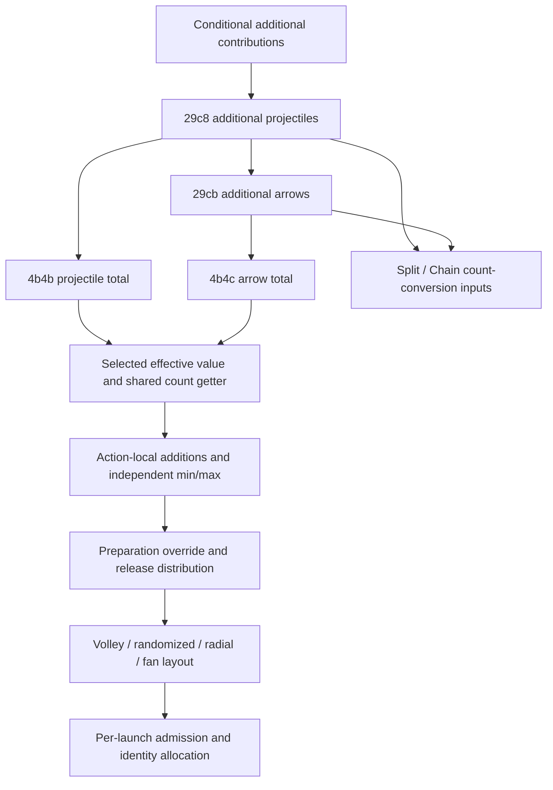

# Projectile and arrow count inputs (3.29.3b)

> Frozen detailed reference from R81. Historical next-step language is provenance, not an active backlog.
> Current scope and unresolved obligations are in [the delivery matrix](delivery-matrix.md) and
> [verification and limitations](verification-and-limitations.md).

Part of [012 — projectile execution](../012-projectile-execution.md).
Four native callbacks supply additional and total counts used by emission and
[Split/Chain conversions](continuation-stat-inputs.md).
Their formulas, current effective provider values and action-local count handling are different layers.

## 1. Input and evidence contract

| Native key | Output | Registration | Callback |
|---|---|---|---|
| `29c8` | `intermediary_number_of_additional_projectiles` | `0x1400ce200` | `0x14280da10` |
| `29cb` | `intermediary_number_of_additional_arrows` | `0x1400ce2a0` | `0x14280efb0` |
| `4b4b` | `virtual_total_number_of_projectiles` | `0x1400ce360` | `0x14280f470` |
| `4b4c` | `virtual_total_number_of_arrows` | `0x1400ce400` | `0x142810190` |

Keys are hexadecimal and one-based: `Stats.json[key-1].Id`.
`S[k]` means a native computation-context input: cached value, otherwise the selected native provider/parent.
It does not imply automatic recursive recalculation on an ordinary network object.
Explicit network overrides, including zero, ordinary effective getters and computation transaction eligibility
retain the [separate contracts already recovered](actions-and-emission.md#62-raw-notifications-and-computed-transactions-are-separate-propagation-mechanisms).

`W` wraps to signed32; `B(x)` is nonzero normalized to 0/1, including negative values.
Integer additions/products wrap before later conversions/comparisons.
The discovery index is an ignored peer artifact identified by path/SHA; all four registrations,
callback pointers, actual dependency arrays and bodies were verified against original PE bytes.

## 2. Additional projectiles `29c8`

This output is the wrapped sum of fourteen contributions, without a final nonnegative clamp:

| Contribution | Native rule |
|---|---|
| Generic | `S[b0 number_of_additional_projectiles]` |
| Boolean extra one | `B(S[2b53 additional_1_projectile])` |
| Spiral nova | `S[877 base_number_of_projectiles_in_spiral_nova] != 0 ? W(S[877]-1) : 0` |
| Hunter equipment | `S[52f0 number_of_equipped_hunter_items] >= 6 ? S[5415 additional_projectile_if_6_hunter_items] : 0` |
| Attack | `B(S[bad skill_is_attack]) ? S[1283 attacks_number_of_additional_projectiles] : 0` |
| Totem | `B(S[94a skill_is_totemified]) ? S[b89 totem_number_of_additional_projectiles] : 0` |
| Spell | `B(S[1b6 casting_spell]) ? S[1359 spells_number_of_additional_projectiles] : 0` |
| Recently hit | `B(S[11b5 number_of_times_have_been_hit_recently]) ? S[1c37 number_of_additional_projectiles_if_you_have_been_hit_recently] : 0` |
| Recent movement skill | `B(S[1857 have_used_movement_skill_recently]) ? S[1c3b number_of_additional_projectiles_if_you_have_used_movement_skill_recently] : 0` |
| Mirage Archer | `B(S[1ce0 skill_used_by_mirage_archer]) ? S[3315 mirage_archer_number_of_additional_projectiles] : 0` |
| Claw/dagger attack | `B(S[bad]) && clawDagger ? S[2bf1 attack_skill_additional_num_projectiles_while_wielding_claws_daggers] : 0` |
| Tincture and recent hit | `B(S[50df tincture_applied]) && B(S[11b5]) ? S[4d4c number_of_additional_projectiles_with_tinctured_weapon_attacks_if_you_have_been_hit_recently] : 0` |
| Wand boolean extra one | `S[3]==6 && B(S[355 skill_can_fire_wand_projectiles]) && B(S[3bcb wand_attacks_fire_an_additional_projectile]) ? 1 : 0` |
| Disgorge | `B(S[57e1 affected_by_disgorge_buff]) ? S[57e0 support_gluttony_fire_x_additional_projectiles_in_nova_while_affected_by_disgorge] : 0` |

For the claw/dagger contribution:

```text
clawDagger = B(WeaponClassByte[S[3]]) || B(WeaponClassByte[S[4]])
             || B(S[1066]) || B(S[1067])
```

`3/4` are the main/off-hand weapon type stats; `1066/1067` are their Varunastra all-one-handed-melee-type flags.
At table `0x142fdd710`, the checked first 24 bytes have nonzero indices 10, 12 and 16.
This is a bounded table observation, not proof that 23 is the maximum valid weapon enum.
The body uses sign-extended indexing without an established range check at this read;
arbitrary out-of-range synthetic inputs must not be treated as safe.

The Tincture and wand contributions have **no additional explicit attack gate** here; the claw/dagger term does.
`2b53` and the wand modifier contribute boolean one, rather than their raw numeric magnitude.
The `877` subtraction is conditional on nonzero and can contribute a negative wrapped value.
Do not replace any of those native rules with a rule inferred from a modifier's name.

The `29c8` registrar lists `4d77 skill_is_weapon_attack`, which this body does not read.
It also omits some actual category/weapon inputs. Registration dependencies are not a complete read inventory
and cannot justify adding a weapon-attack gate to the formula.

## 3. Additional arrows `29cb`

```text
W(S[29c8] + S[b1 number_of_additional_arrows]
 + (S[124 main_hand_accuracy_rating] >= 3000
       ? S[1ba0 number_of_additional_arrows_while_main_hand_accuracy_is_3000_or_more] : 0)
 + (!B(S[2f88 have_cast_dash_recently])
       ? S[2f8e number_of_additional_arrows_if_havent_cast_dash_recently] : 0))
```

This callback has no bow/arrow eligibility test or output clamp.
The subsequent consumer chooses whether this arrow alias applies.
The accuracy threshold is signed and inclusive; the Dash condition is zero versus nonzero.

## 4. Total counts `4b4b/4b4c`

Both callbacks first execute these early returns in order:

```text
if !B(S[373e skill_fires_projectiles]): return 0
if B(S[3181 fires_1_projectile_if_no_steel_ammo])
   && S[30f5 current_steel_skill_ammo] == 0: return 1
```

They then form different signed base quantities:

```text
projectileBase = max(1, W(S[4b4a base_number_of_projectiles]
                        + S[38fe eye_of_winter_base_explosion_shards]
                        + S[4d6d power_siphon_base_fire_at_x_targets]))
arrowBase = max(1, W(S[4b4a] + S[4b4d base_number_of_arrows]))
```

If any of these conditions holds, immediately return that base, skipping additional count, all later multipliers
and this callback's final minimum/maximum:

| Key / condition | Meaning |
|---|---|
| `B(S[46d9])` | `modifiers_to_projectile_count_do_not_apply` |
| `B(S[386e])` | `spectral_spiral_weapon_base_number_of_bounces` |
| `B(S[47c1]) && S[4787]==0` | Vaal Ice Shot modifier exclusion with zero maximum mirages |
| `B(S[29c7])` | `modifiers_to_number_of_projectiles_instead_apply_to_splitting` |
| `B(S[4ead])` | `modifiers_to_number_of_projectiles_instead_apply_to_chaining` |
| `B(S[4fe9])` | `kinetic_blast_modifiers_to_number_of_projectiles_instead_apply_to_number_of_clusters` |
| `B(S[5a16])` | `modifiers_to_number_of_projectiles_instead_apply_to_number_of_summoned_ghost_cannons` |

Otherwise let `additional=S[29c8]` or `S[29cb]`, respectively, and calculate:

```text
steel = 1f
if S[3147] != 0:
    cap = S[373c]
    current = S[30f5]
    used = cap >= current ? max(current,0) : cap
    steel = max32(0f, f32(f32(W(100 + W(S[3147]*used))) / 100f))
locus = max32(0f, f32(f32(W(100 + S[4a36])) / 100f))
skill = max32(0f, f32(f32(W(100 + S[26f2])) / 100f))
n = cvttss2si(f32(f32(f32(f32(W(base+additional)) * skill) * locus) * steel))
lo = B(S[4a37])
hi = B(S[56ee]) ? 1 : INT_MAX
return min(max(n,lo),hi)
```

`3147` is `number_of_projectiles_to_fire_+%_final_per_steel_ammo_consumed`;
`373c` is `virtual_steel_ammo_consumed_per_use`.
`4a36/26f2` are the final percentages from Locus Mine/the skill; `4a37/56ee` select minimum/maximum one.
Keep the exact ammo selection for exceptional negative caps: it is not a clamp with both bounds made nonnegative.
Each operation rounds to float32, and multiplication order is **skill → locus → steel**.
The steel baseline includes 100 before conversion. None of these four count callbacks uses Split/Chain's subtraction of one.
`max32` preserves the native comparison/pointer-selection semantics; `cvttss2si` invalid-range behavior and
nondefault floating environments must not be silently replaced by host arbitrary-precision conversion.
The finite normal paths and selected exceptional synthetic cases are tested; official reachability is separate.

## 5. Formula output is still upstream of release and layout



This is a dependency/consumer diagram, not a claim that an ordinary network object invokes all formula boxes.
The shared getter `0x141ba6070` uses virtual `+0x598` to select `4b4b/4b4c`;
it also conditionally adds action-local counts and independently applies effective `4a37/56ee` bounds.
Thus a formula's raw bypass can return a base above one while the later getter still limits its result to one.
Those two reads need not have identical provider/timing premises.
Preparation's nonzero `1884 number_of_projectiles_override` and per-release distribution are separate branches,
described in [actions and emission](actions-and-emission.md#2-effective-count-and-release-count).
Total skill count, count on this release, count at one Volley point and skill-generated child count remain distinct.

## 6. Evidence and remaining inputs

Round22 `count-input-audit.py/json` checks 13 functions / 23 aligned ranges / 3504 instructions,
four registrations/dependency arrays, 78 anchors and eight float constants.
The cache-store leaf has an explicitly verified boundary instead of a neighboring unwind owner.
`count-input-numeric.py/json` compares a decoded-original-instruction interpreter with separate formulas:
5043 synthetic cases, including twenty named expected-value controls, threshold neighbors, all total bypasses,
integer wrap and float32/steel/clamp boundaries. Distinct interpreted instruction counts are 252/62/233/226
for the four callbacks, respectively; unentered provider paths are not counted as numeric coverage.
Independent review checks the complete original bodies, registrations, formula gates and numerical provenance.

This closes selected computations, not their complete raw source graph, transaction activation/invalidation,
actual official wire values, every skill's reachable combinations or real-time action-local field state.
No native execution, new capture, server implementation or CI change occurred.
