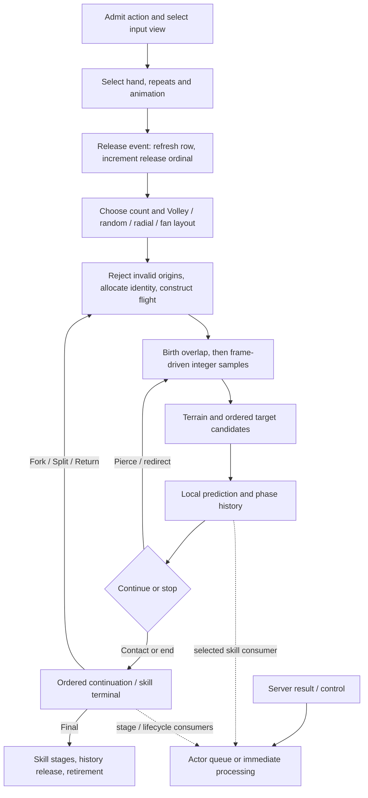

# Shared projectile execution model

Part of [RE 012](../012-projectile-execution.md).
This guide summarizes S evidence; references retain exact branches, arithmetic and fixture boundaries.
It is a client execution contract, not complete server-ready pseudocode.

## 1. Execution spine



The result queue has several consumers; contact is not universally required or sufficient to consume it.
A motion callback can replace movement, so the next sample must inspect current state again.

## 2. Action and release state

Keep these independent:

| Value | Width / state | Meaning |
|---|---|---|
| Sequence | u16, `+11a` | Root action identity |
| Derived byte | u8, `+11c` | Registered action identity allocated across related actions |
| Result stage | u8, `+120` | Skill reason/stage lifecycle, not successful-hit count |
| Source ordinal | u32, `+448` | Per-admitted-projectile construction/hash input |
| Release ordinal | u32, `+3f8` | Preincremented once per release callback |
| Repeat state | outer `+2d0/+2d4`, inner `+2b8/+2b9` | Remaining and total repeats, not projectile count |
| Continuation state | counters and flags | Copied or changed by the reached executor |

The shared allocator starts at low byte one; ordinary allocations return 2 through 255, then repeat from 2
while incrementing a separate epoch byte.
The wire result key does not carry that epoch.
Registration appends the action to the Actor's retained vector.
TS uses an intermediate template identity separately from flying-child allocations.

Normal start conditionally resets source ordinal; inner timeline rewind retains it.
Release increments its ordinal before dispatch; inner remaining repeats decrement after release.
Seeds normally see remaining counts `K,K-1,...,0`, not an increasing loop index.
Qualification, selected-hand and Buff repeat state precede their dependent reads.
See [release/repeat](release-and-repeat.md), [Buff inputs](repeat-source-state.md) and [hands](hand-selection.md).

## 3. Counts and layout

The effective view may be a retained skill set or the last action override.
Explicit local zero can shadow a parent; a raw update does not automatically rerun every computed callback.
Formula evaluation, publication and action caches must not become one continuously recomputed profile.

Bow equipment with `skill_can_fire_arrows` selects total-arrows `4b4c`; other traced cases use total-projectiles
`4b4b` (hexadecimal keys).
Their base/additional formulas, conversion bypasses and clamps are in [count inputs](count-stat-inputs.md).
Skill total, this release's count, rays at a Volley point and skill-created child count are distinct.

For the multi-projectile branch, precedence is nonzero Volley, random-direction, radial, then ordinary fan.
Count one has a separate direct creation path and must not inherit the multi-layout admission/draw contract.
TS secondary forces radial admission and disables ordinary Volley points; random-direction still precedes it.
For ordinary finite inputs and `n>1`, the fan uses:

```text
m = (100 + spreadPercent) / 100
cap = min(2*pi, m * 2.094395160675049)
if fixedSpread != 0:
    step = max(fixedSpread, 0) * (pi/180) / (n-1)
else:
    step = max(min(atan(m * spread / aimDistance), cap/(n-1)), 0.14279967546463013)
theta[i] = -(n-1)*0.5*step + i*step
```

Native code uses ordered binary32 operations and native trig.
Default `spread=60` is an input to atan, not a final angle of 60 degrees.
A nearby cursor can widen the fan.
Negative fixed spread selects the fixed path and yields zero step.
Volley offsets origins and aims by the same lateral offset, preserving parallel rays before other modifiers.
Side-origin admission, group seed mutation and count distribution are in
[actions/emission](actions-and-emission.md) and [layout inputs](layout-stat-inputs.md).
Rejection before allocation can change subsequent identities and seeds.

## 4. Randomness is several contracts

The uint32 generator resembles TinyMT32 but has a different transition.
Four-, five-, seven- and eight-word initializers are not interchangeable or zero-padded aliases.
Bounded sampling rejects the unusable upper bucket, consuming another raw draw when necessary.
Zero-variance branches skip their draw; other reached checks draw even at particular chance endpoints.

- Batch variance: `[sequence, emittingByte, stage, outerRemaining, releaseOrdinal]`.
- Motion/TS terminal: `[sequence, arrowByte, ownerId, outerRemaining, innerRemaining,0,0,0]`, initialized freshly
  at the corresponding caller; equal recipes do not mean a shared advancing stream.
- Bounce: `[sequence, derivedByte, incrementedBounceCount, ownerId]`, four-word initializer.
- Object seed: pure hash after admission/allocation, not a draw.
- TLS: enclosing state and consumer order, separate from action-seeded streams.

[Random inputs](random-inputs.md) gives the recipes, distributions and short circuits.
Gameplay TLS initial state and complete enclosing consumer order remain critical gap **K1**.
Deferred visual code must still preserve draws if it shares gameplay TLS state.

## 5. Motion, height and contact

Simulation uses integer cells/height markers and separate rendered interpolation.
World-to-grid conversion, sentinels, model attachments and terrain height are different inputs.
No universal client "add five" rule has been recovered for all projectile/effect paths.

For the ordinary finite nonoverflow sampler, choose the dominant axis (X wins XY ties; explicit height wins
only when strictly larger), set minor errors to `-floor(length/2)`, then add minor deltas each step.
Advance a minor coordinate only when error is **strictly greater than zero**.
Source is excluded and endpoint included; birth overlap is separate.
Forward `(0,0)->(4,2)` visits `(1,0),(2,1),(3,1),(4,2)`; reverse traversal is not its exact reverse.

An update accumulates elapsed time and progress budget, then visits due samples.
Samples perform bounds, terrain-layer and spatial-candidate checks before commit/notification.
Observers can install another movement; residual rescaling matters on redirect.
Shared straight/arc initializers clear the optional progress curve in the traced setup.
Arc height is a separate polynomial, not terrain-relative straight-line interpolation.
See [motion/contact](motion-and-contact.md) and [speed/time](motion-speed-and-time.md).

Terrain selectors, collision hulls and target body/range tests are query inputs.
A rendered wall/beach alone does not identify a layer's rule.
Local attack entropy and spell avoidance can reject and remember contacts without consulting the S2C queue.
That is prediction/admission, not authoritative resource change.

## 6. History, shotgun and continuation

History contains three processed-target vectors and derived-byte-to-next-target reservations.
The traced phase selector chooses outbound, first Return or additional Return without clearing earlier sets.
Some miss/avoid paths remember targets too; remembered ID does not prove damage.

| `canShotgun` | Preserve history requested and available | Emitted history |
|---|---|---|
| false | yes | Shared source payload |
| false | no | One new empty batch payload |
| true | yes | Separate deep copy per action, including ancestor contacts |
| true | no | Separate empty payload per action |

Fork/Split and the traced Return clone explicitly preserve history.
Chain ordinarily redirects the same action and coordinates siblings through reservations.
Removing a reservation neither erases target sets nor decrements the history's strong reference.

Contact checks validity/history/local prediction, then Split before Pierce, otherwise retains a stop.
Terminal has explode-only and skill branches before ordered continuation executors.
Do not replace its conditional Split/Fork/Chain/Bounce/Return branches with an unconditional universal chain.
Cannot-pierce precedes forced/return-always success; other prohibitions/conversions have their own read order.
Fork/Split copy updated counters and flags instead of resetting all budgets.
Target selection includes traversal, sorting/ties and reservations, not just nearest Euclidean distance.
See [continuation](continuation-and-memory.md), [stat inputs](continuation-stat-inputs.md),
[Split ordering](split-target-order.md) and [Chain admission](chain-candidate-admission.md).

Final dispatch, history release, retained-action removal, flight removal and Entity destruction are separate.
R81 TS controls connect source retirement/listener cleanup with live descendants, without draining Entity removal
or establishing populated-component destruction and official World timing.
