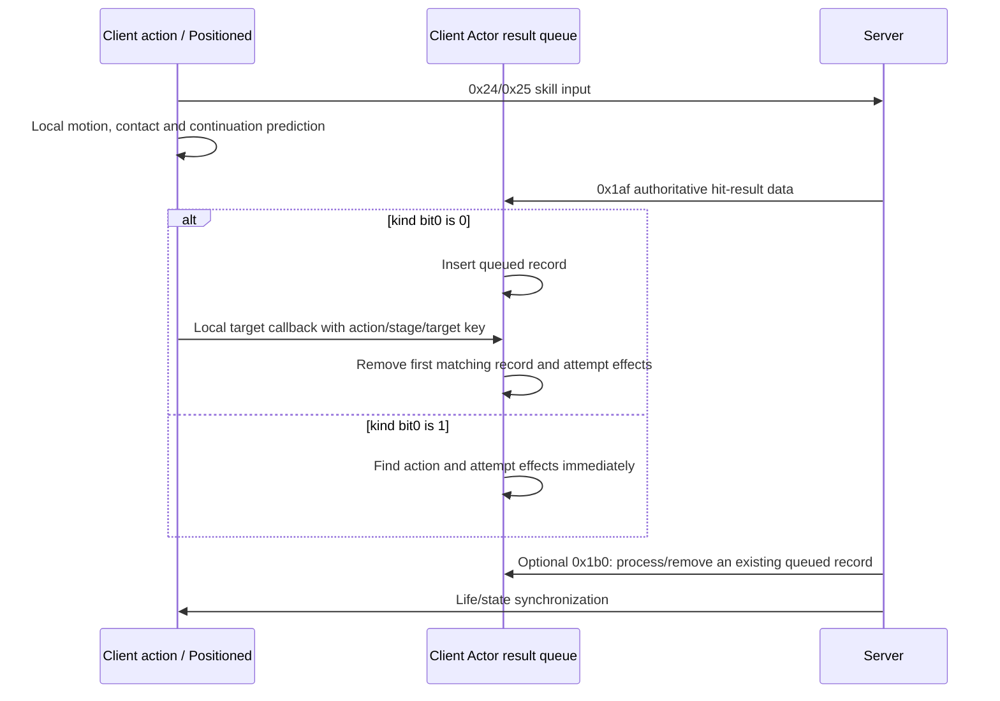

# Projectile results, action keys and queue lifecycle (3.29.3b)

> Frozen detailed reference from R81. Historical next-step language is provenance, not an active backlog.
> Current scope and unresolved obligations are in [the delivery matrix](delivery-matrix.md) and
> [verification and limitations](verification-and-limitations.md).

Part of [012 — projectile execution](../012-projectile-execution.md).
Packet framing and existing fields remain in [11 — skills](../../protocol/11-skills.md).
This chapter describes how the client uses the result, with S/L/I/U evidence labels from the parent chapter.

## 1. Input, local prediction and authoritative result are separate

**S:** C2S `0x24/0x25` sender `0x142166300` carries the selected skill/target, action sequence and flags.
The traced sender contains no later per-projectile contact list, wall hit, secondary directions or continuation results.
It uses instance `+0x20` observer vtable `0x14345eaf8`, slot `+0x10`.

The client also performs local flight/contact/continuation prediction.
The traced attack contact gate computes accuracy/evasion/entropy without looking up the pending hit queue.
The concrete Fireball spell gate reaches local spell-dodge calculation `0x141ebd2f0`.
Sequence/derived/stage arguments also participate in local prediction;
their presence alone does not identify a queued-result consumer or an outgoing report.
Some subsequent target-effect callbacks consume server-supplied hit results.
Neither path establishes client-authoritative damage or an outgoing contact report.



The ordering is illustrative; exact server timing and late-result policy are not yet reconstructed.
An effect may fail after consumption if its target/context no longer exists.

## 2. Handle layout, sorting and duplicates

**S:** Actor `+0x200/+0x208/+0x210` is a vector of records with stride `0x88`.
Handle reader `0x14195dde0` and action lookup `0x141939f40` establish:

| Meaning | Local source | Record field | Wire handle order |
|---|---|---|---|
| Action sequence | action `+0x11a:u16` | `+0x40:u16` | 1: u16 |
| Derived action byte | action `+0x11c:u8` | `+0x42:u8` | 3: u8 |
| Result stage | action `+0x120:u8` | `+0x43:u8` | 2: u8 |
| Target object ID | object `+0x88:u32` | `+0x44:u32` | 4: u32 |

The two byte fields have reversed wire/memory order.
The existing server API names `actionByte/skillIndex` do not explain this full contract.
Reader `0x1419bd6f0` stores kind bit 0 at record `+0x48` and bit 1 at `+0x49`.
Those are unpacked record fields, not extra bytes inside the wire handle.

Comparator `0x14195de60` sorts **only** `(unsigned sequence, derived, stage)`.
Target ID is not part of that comparator.
Consumers obtain the equal three-field range and linearly find its first matching target.
The insertion path uses upper-bound insertion without full-key deduplication.
Identical four-field records can coexist; one exact consumption removes one record.
No wrap-aware sequence-age calculation was found in this comparator.

### 2.1 Derived allocation does not extend the result handle with an epoch

Base construction `0x141937cc0` initializes the shared allocator's word to 1;
the lazy wrapper `0x141421a10..0x141421acf` uses the same initializer.
Allocator `0x14193dc60` normally increments and returns its low byte.
At low byte 255 it resets that byte to 1, increments a separate epoch byte, then returns 2.
Thus this initialized stream allocates 2 through 255 repeatedly, rather than emitting 0 or 1 at rollover.
The epoch-255 path calls a wrap diagnostic; that helper's full side effects remain untraced.

Immediate-result and `0x1b0` action lookup scan retained actions forward and accept the first sequence/derived match.
The checked registrar appends actions without conflict deduplication.
Neither checked lookup includes the allocator epoch or uses result stage to disambiguate the action itself.
If equal wrapped identities coexist, these lookups can select an earlier retained action;
their actual coexistence/lifetime and any wider prevention mechanism remain unresolved.
Stage matching still applies independently when locating a queued result record.
Round12 `allocator-wrapper-full.asm`, `allocator-wrap.asm` and `action-result-lookups.asm` retain these boundaries.

## 3. Incoming 0x1af

**S:** Actor handler `0x141e90f50` has two distinct branches:

```text
if record.kindBit0 == 0:
    insert_after_equal_sequence_derived_stage(record)
else:
    action = FindAction(record.sequence, record.derived)
    stats = action.selectedStatView if action exists else emptyStats
    Actor.ProcessResult(record, stats, actionOrNull)
```

The queued branch does not check whether the action exists or whether its local stage has already passed.
The immediate branch does not fall back to queueing when action lookup fails.
It still calls Actor `+0x230 = 0x141e91580` with empty stats/null action.

Action lookup uses:

- derived zero: current action at Actor `+0x1b0`, with matching sequence;
- derived nonzero: retained actions at Actor `+0x1e8..+0x1f0`, matching sequence and action `+0x11c`.

The found action selects its current view using stat-set selector `+0x174`, including override-stack precedence.
This is distinct from result-stage byte `+0x120`;
the message's stage does not select a historical stat snapshot in this lookup.
`+0x230` then checks target existence/state and can return false without showing an effect.
This is presentation/result processing; life is synchronized separately through authoritative state messages.

### 3.1 Actual payload decoding, fresh defaults and dispatch

**S:** the installed message reader `0x141fddba0` first reads the common object/order header, then tail-calls
`0x1419bd6f0` with `message+0x20`. That address is the result-record base used below, rather than another wire
header. The complete reader ends at `0x1419bd817`; neighboring `0x1419bd820` is a different reader.
The actual `0x14195dde0` handle reader and its `WS2_32!ntohs/ntohl` imports establish network byte order.

| Order after common header | Wire field | Result-record destination | Presence |
|---|---|---|---|
| 1 | big-endian u16 sequence | `+0x40` | always |
| 2 | u8 stage | `+0x43` | always |
| 3 | u8 derived | `+0x42` | always |
| 4 | big-endian u32 target | `+0x44` | always |
| 5 | big-endian u16 flags | `+0x36` | always |
| 6 | u8 kind | bit 0 to `+0x48`, bit 1 to `+0x49` | always |
| 7 | big-endian u16 optional magnitude | `+0x34` | kind bit 1 and flags `0x400` |
| 8 | u8 code, u8 angle | `+0x39`, `+0x3a` | kind bit 1 |
| 9 | big-endian u16 optional word | `+0x3c` | kind bits 1 and 2 |
| 10 | big-endian u16 optional word | `+0x3e` | kind bits 1 and 3 |

The immediate bit does not imply hit data, and hit data does not imply immediate processing.
For example, kind `0x0c` has no hit-data bit and reads neither optional word; kind `0x0f` reads both.
Bits 4 through 7 do not affect this reader's field presence or its two stored kind booleans.
With the common 12-byte header, these selected messages consume 23 through 31 bytes; the payload alone is
11 through 19 bytes. These lengths are parser contracts, not assertions that every syntactically supported
kind/flags combination is emitted by the official server.

The fresh `0x1af` factory branch `0x1421c6509..0x1421c659d` establishes zero defaults for all five optional
destinations above before invoking the reader. In particular, the qword store at message `+0x50` covers
record `+0x34`; stores at message `+0x58/+0x5a/+0x5c` cover code, angle and the two optional words.
The reader itself does **not** clear omitted fields when invoked on an existing record. A direct reread can
therefore preserve previous optional values, whereas this fresh network factory path does not inherit them.
Do not replace either claim with an assumption that the complete allocation is zero-filled.

The actual `0x1b0` factory branch is `0x1421c659d`, installs table `0x1435dda58`, and calls reader `0x141fddc20`.
That reader uses the same common header and handle reader, then reads one control byte and stores
`byte != 0` at message `+0x28`. Thus all nonzero wire values become one; the complete selected message is
21 bytes. Actor dispatch cases `0x142195299` and `0x1421952aa` pass the record/handle at message `+0x20`
to `0x141e90f50` and `0x141e90c30`, respectively.

Round47 seals the actual readers, both Actor handlers, equal-range helper and call-bound comparator.
Finite controls execute the real pump/factory/header/payload/intake path, then a separately supplied Actor
dispatch entry. Poisoned allocations distinguish construction defaults from omitted-field preservation.
The Actor controls use empty-owned-container copy/move/destruction fixtures, a selected-stat getter fixture
and an observing `ProcessResult` that deliberately returns false. They check unsigned three-field ordering,
target-independent insertion order, first duplicate removal and missing-control/no-future-tombstone behavior.
They do not execute the full World-to-Actor lookup, successful feedback or numerical damage.
Stream copying/prefetch and allocation/storage are also fixtures; this is offline original-instruction
interpretation, not native client execution or an official traffic recording.

## 4. Local target consumption

**S:** KB client vtable `0x14326b9c0 +0x7c0` and Rain client vtable `0x1433f2370 +0x568` both point to
`0x1412e9d10 → 0x141939f40`.
The latter matches the current action's sequence/derived/stage and the target ID:

```text
record = FirstExactMatch(queue, sequence, derived, currentStage, targetId)
if missing: return false
copy and remove record
Actor.ProcessResult(record, action.selectedStatView, action)
return true
```

There is no pending-target retry item or outgoing request in this function's missing-result branch.
The returned true means a record was found/consumed; the function does not use `ProcessResult`'s success to requeue it.
The caller decides what to do with false; KB's target loop continues enumeration.
Do not infer that a missing package stops all local flight or prevents every location-based effect.
KB has a separate location-effect callback `+0x7c8`.

### 4.1 Joining a KB explosion to actual current-stage consumption

**S:** the bounded composition in section 6.1 also starts a separately supplied, registered KB group at stage 3,
with two supplied explosion centers and a trigger Entity pointer. It executes explosion `0x141ac7040`, native
bucket/radius enumeration `0x141acc1f0`, candidate filters `0x141acb9e0/0x141acbb90`, and the installed
`+0x7c0 → 0x1412e9d10 → 0x141939f40`. The wrapper reads the candidate Entity ID at `+0x88`.
Radius, clear-path output, component registration, vector allocation and group construction/identity are supplied;
the source-contact-to-clone producer and the complete radius formula are not executed in this composition.

The first explosion rejects the supplied trigger target before exact consumption. For another accepted target 202,
it consumes the first matching stage-3 record, leaving its duplicate and future stage-4 record queued. The queue is
already compacted and Actor `+0x208` reduced when observing `+0x230` is entered, with the KB group as the action.
An explicit false ProcessResult return does not requeue the record. Only afterward does the original explosion
call its local effect slot `+0x7c8`, then advance the group stage. On a second explosion, the same accepted target
consumes its stage-4 record; the leftover stage-3 duplicate remains. No whole-group target suppression is inserted.
This joins local callback/result identity, not authoritative damage admission or a completed damage calculation.

A late-result control first executes the stage-3 explosion without a matching result. After inserting that old-stage
record through actual Actor ingress, the stage-4 explosion visits the same target but does not consume the old key.
Stage batching retains it; a matching later `0x1b0` removes it and attempts processing. Thus a subsequent local
explosion is not an automatic replay of a missed earlier exact lookup. This finite path does not establish every
late-result recovery source or the official server's choice of recovery route.

### 4.2 Joining source-generated KB groups to scheduled results

**S:** the [KB lifecycle composition](fireball-and-kinetic-blast.md#31-joining-an-emitted-source-to-its-constructed-explosion-group)
removes section 4.1's supplied group/derived/centers boundary. On the same emitted KB action, the installed reason
prefix executes the original copy chain, shared-counter allocation, same-Actor registration and seeded position
generation. Registration activates before positions are generated; source advancement follows generation.
The finite source `(4660,2,3)` creates group `(4660,3,3)`, then the source advances to stage 4.

Parsed results still enter through the original Actor ingress. Four body-inclusive visits from that group's
installed timer/explosion consume target-202 keys `(4660,3,3..6)` in order. The trigger's stage-3 record and an
extra target-202 stage-3 duplicate remain queued. Original effect-call-before-stage order is preserved, while
observing ProcessResult returns false. Supplied World getter modes 1 and 2 both pass this control.
Four effects do not establish four successful damage applications; numerical processing is an explicit boundary.

Timers and stages follow the **retained position list**, not original sector indices. Omission of one sector
produces three effects and three stage advancements, with no empty result stage or delay for that sector.
An inherited stage 255 wraps through explosion stages 255/0/1/2; the source has independently wrapped to zero.
Successive source invocations allocate separate group-derived keys and copy successive source stages.

Base construction, selected stats/cache refresh, downstream activation and subscription delivery, terrain and
radius outputs, target metadata/components/registration, deeper prediction, owned storage, presentation and
ProcessResult remain supplied. This does not close actual first-update/frame placement, packet publication or
arrival order, every late-result recovery path, all owner/mode cases or the official server's damage-admission rule.

## 5. S2C 0x1b0

**S:** `0x141e90c30` receives an eight-byte handle and an extra process byte from the Actor dispatcher:

```text
record = FirstExactMatch(queue, fullHandle)
if missing: return
copy and remove record
if processByte != 0:
    action = FindAction(record.sequence, record.derived)
    Actor.ProcessResult(record, action.selectedStatView or emptyStats, actionOrNull)
destroy temporary record
```

Process byte zero removes without processing.
A nonzero byte attempts processing even when no action is found.
A missing record is a no-op: this handler does not create a cancellation tombstone for a future `0x1af`.
This describes handler behavior, not packet reordering over TCP.
If local contact already consumed the result, a later `0x1b0` also finds nothing.
Only the first matching duplicate is removed.

## 6. Stage/end batching is filtered, and ordinary queued records can survive

**S:** three paths call range processor `0x141e91330`:

| Trigger | Entry | Selected range |
|---|---|---|
| Advance result stage | `0x14193a170` | same sequence/derived, stage 0 through the saved old stage; action stage is incremented before range processing |
| End current root action | `0x141e8f780` | same sequence, derived zero, all stages |
| Remove retained derived action | Actor `+0xf8 = 0x141e930e0` | same sequence/derived, all stages |

The comparator covers all target IDs within those ranges.
Predicate `0x141e91500` selects individual records:

```text
if record.kindBit0 != 0:
    remove and add to processing list
elif world.slot1b0() == 0:
    Actor.slot238(record.handle, false)
    remove without adding to processing list
else:
    keep in queue
```

Collected processing records later reach `+0x230` with null action.
`+0x238` is a no-op in the checked Actor/ClientActor tables; other implementations remain separate.

The actual client world tables `0x1435da318` and `0x14346e0c8` bind `+0x1b0` to `0x14164dc70`:

```text
return 1 + (world.byte984 == 2)
```

[07 — network modes](../../protocol/07-latency-visibility-movement.md#6-lockstep-not-served-yet) identifies raw
world `+0x984 == 2` as Lockstep.
These concrete client getters therefore return 2 for that state and 1 otherwise, including ordinary Predictive.
Neither returns zero; the getter result is not the same enumeration as the raw field.
The business meaning of zero for other World implementations remains unresolved.

**I, directly from these bindings:** ordinary queued `0x1af` records have kind bit 0 clear, so stage/end batches
**retain** them in both checked client modes.
Advancing a stage or ending an action does not by itself automatically replay or delete every unmatched result.
Exact local consumption and `0x1b0` are the identified targeted removal paths.

The stage helper first retains the old byte in `edx` at `0x14193a1ea`, then writes its increment at
`0x14193a1f4`; the selected range still ends at the **old** stage, including 0 through 255 when the byte wraps to zero.
Entering that range processor is not
evidence that an ordinary queued record was processed. The predicate's three dispositions are:

| Record / getter condition | Removed from queue | Added to processing list |
|---|---|---|
| kind bit 0 set; getter not queried | yes | yes |
| kind bit 0 clear; getter zero | yes, after `+0x238(handle,false)` | no |
| kind bit 0 clear; getter nonzero | no | no |

The final Fireball stage callback is subject to this same filter. Its terminal stage advancement therefore
does not close the missing ordinary local exact-consume edge. Round17 `result-applicability.asm` and
`result-applicability-audit.json` independently retain the selected caller/predicate/getter bytes and concrete
World/Fireball bindings. Official route choice remains distinct from these established static rules.

### 6.1 Joining emitted contacts, installed skill callbacks and the same Actor queue

**S:** this extends the [registered terminal composition](motion-and-contact.md#10-joining-registered-notifications-to-terminal-and-return).
It removes the supplied reason-callback output for ordinary ranged `Melee`, TS and ordinary BA, executing final
`+0x530 → 0x1412e34e0/0x141ac59d0`, their real second-advance qualification, stage helper `0x14193a170`,
lower/upper range searches `0x141e9f090/0x141e9f160`, range processor and predicate on the same source Actor queue.
The supplied Entity component array binds that Actor, whose real final table is `0x14346e558`.
The final World getter `0x14164dc70` executes against supplied raw mode bytes 1 and 2; it is not a supplied bool.

Parsed record objects enter through original Actor dispatcher slices `0x142195299..0x1421952a5` (`0x1af`) and
`0x1421952aa..0x1421952bb` (`0x1b0`), then their real handlers. Byte decoding/factory/intake is independently
covered in section 3.1; the supplied dispatcher receiver/parsed objects do not execute a whole World delivery.

The finite controls establish the following joined behavior:

- Ordinary queued records are selected by the actual old-stage range but retained in both supplied client modes.
  Other sequence/derived identities and future stages stay outside that range; all targets of selected stages
  participate. Stage 255 increments to zero while still selecting through old stage 255.
- A target stop and a natural end invoke their installed reason callback before final cleanup. A single flight
  that Pierces target 101 and stops at 202 executes reasons 2 then 0 and advances stages 3→4→5; neither advancement
  consumes its queued ordinary records. These are reason transitions, not a count of damaging hits.
- Matching later controls remove those old-stage records before observing ProcessResult. Retained-action lookup
  resolves the same sequence/derived action even though its current stage has advanced. In these inputs, the current
  selected stats are passed, not a reconstructed historical stage-specific stat snapshot.
- Fireball's actual `0x1413dfd00` callback executes on Pierce reason 2 and Return reason 7. Both advance stage and
  naturally skip reason-0 explosion presentation. Return still redirects/resumes the same action. Matching queued
  controls and immediate-kind ingress both attempt processing of its old-stage key after that stage transition.
  This establishes supported routes, not which one the official server uses for ordinary Fireball hits or AoE.
- The separately supplied KB group joins local candidate selection to exact consumption and per-explosion stage
  advancement as described in section 4.1; it is not an executed source-contact/clone lifecycle.

Ignored `round54/audit_stages.py` and `stage-audit.asm/json` bind original complete-unwind/bounded-leaf ranges,
final slots and transition anchors. `check_stages.py`/`stage-controls.json` extend the sealed R53 interpreter with
one-operand signed IMUL semantics and execute the joined controls. This is original-instruction interpretation,
not native client execution. Record copy/move/destruction is restricted to explicitly empty owned containers;
ProcessResult is an observing fixture returning false. Construction/clone, actual stat grants/cache refresh,
target/component/terrain inputs, deeper numerical prediction, weak handles, final presentation, KB group/radius/
clear-path/storage/effect inputs and authoritative damage remain outside these joins. Ordinary raw mode inputs
do not establish full Predictive/Lockstep, remote-player or monster equivalence. Actual scheduling, remaining
continuation executors and all late-result policies remain open.

## 7. Retained actions, reset and late results

The [ordered release/checkpoint composition](world-scheduling.md#101-joining-ordered-result-application-to-an-actual-release)
now connects original World `+0x90`, both generic dispatchers and these Actor ingress/control bodies to a
six-witness actual release. A supplied ordered nonzero-mode queue can insert before release and remove/process
after movement preparation; the second checkpoint is conditional, not per arrow. Duplicate, early-control,
missing-action and separate retained-derived controls retain the queue rules above. The later
[wire composition](world-message-inputs.md#31-joining-wire-receipt-to-release-checkpoints-and-activation) supplies
independent valid bytes through the original readers, owner intake and vector growth to these checkpoints;
it also joins actual activation replay and selected frame controls. Lookup/storage, ProcessResult and actual
mode/core/TLS production remain boundaries; this is neither official send-order evidence nor a numerical Hit-to-pool join.

The later [core composition](world-scheduling.md#41-joining-the-cores-ordering-production-component-updates-and-queue-cleanup)
adds actual object/component ordering production and queue cleanup around an explicit component callback into
that release. Predictive drains its initial batch before the callback; nonzero mode can interleave and later drain
records beyond those checkpoints before a delimiter. Thus checkpoint head blocking alone does not establish
whole-frame retention or a late-result policy. Native Actor runner/root/timeline and ProcessResult effects remain
boundaries, as do actual outer scheduling and original-server choices.

**S:** Actor runner `0x141e8ef50` iterates a copied retained-action list.
It ticks actions via `+0x118` until action `+0x122 & 0x10` selects removal via Actor `+0xf8` and destruction.
This is a state-driven action lifecycle, not a per-hit queue TTL.
The [World scheduling supplement](world-scheduling.md) connects the concrete component runner in both checked modes,
including float-delta sources, snapshot timing and actual common clone admission through `0x14193daf0`.

Actor reset/cleanup `0x141e8c890` destroys all queue records and resets end to begin before cleaning up actions.
Actor destructor `0x141e8cb20` calls that cleanup and releases vector storage.
The bounded scan of Actor `0x141e8c000..0x141e9e900`, direct queue-field accesses and known record destructors
did not locate a general record-age/TTL scan.
It does not establish the absence of every other cleanup source in the executable.

| Scenario | Established behavior | Remaining contract |
|---|---|---|
| Queued result precedes matching local contact | local callback removes and processes first match | effect flags, target/context validity |
| Local contact precedes queued result | local lookup returns false; later package may still enter queue | server scheduling/fallback, no automatic contact replay found |
| Queued result's action no longer exists | insertion does not reject it; ordinary client end batches can retain it | later `0x1b0` or other cleanup policy |
| Immediate result has no action | processing attempted with empty stats/null action | which effects remain valid |
| `0x1b0` has no queued result | no-op, no future cancellation state | complete server send-order policy |
| Actor reset/destruction | pending records destroyed without playback | all area/transfer/removal callers of cleanup |

Do not invent an expiry value or assume all late results are automatically repaired.

## 8. Processing a consumed record is another admission boundary

**S:** `Actor.ProcessResult`, entry `0x141e91580`, does not unconditionally play every consumed result.
It resolves the target ID through `0x141ebefd0` and rejects a missing target,
target object flag bit 0 set or bit 3 clear (`0x141e9162e..0x141e9165c`).
Further component/state/stat and relationship checks can leave before the ordinary feedback path.
An exact queue match therefore proves consumption, not successful presentation or damage.

Reader `0x1419bd6f0` stores wire flags at record `+0x36`, optional magnitude at `+0x34`,
code at `+0x39`, angle at `+0x3a` and optional kind-bit-2/3 words at `+0x3c/+0x3e`.
The code, angle and optional words are all inside the kind-bit-1 hit-data branch;
magnitude additionally requires flags `0x400`.
These fields must not be confused with the identity at `+0x40..+0x47` or the unpacked kind bits at `+0x48/+0x49`.
The feedback-angle conversion at `0x141e91d5b..0x141e91d76` is
`f32(f32(float(angleByte)/255.0f)*6.2831854820251465f)`;
the constants are at `0x1436a3df4/0x1436a3674`.
Byte 255 maps to the full-turn endpoint; replacing the divisor with 256 changes this client-facing input.
When `+0x49` is clear, processing skips the guarded hit-data block at `0x141e91863`,
but still reaches later generic result dispatch if the earlier admission checks pass.
The hit-data path can also modify flags/magnitude before later dispatch:
for example a failed target virtual `+0xc8` clears flags `0x400` and zeroes `+0x34`
at `0x141e91d27..0x141e91d30`.
The complete flag meanings and every special-state guard remain separate reconstruction work.

Two action-specific result callbacks are reachable only with an action and `record+0x49 != 0`:

| Order | Call site | Action slot |
|---|---|---|
| Before Actor result listeners | `0x141e92053` | `+0x2d0(record, target)` |
| After Actor result listeners | `0x141e920ae` | `+0x2d8(record, target)` |

The caller selects the Actor's inline listener-container address `+0x2e8` for hit data and `+0x368` otherwise,
then invokes generic iterator `0x141e9ebb0`; these offsets are not Actor vtable slots.
The final concrete Default ranged, Burning Arrow, ordinary Fireball, KB and TS tables all bind **both** action slots
to `0x1400f0f00`, a void no-op (`ret 0`).
This closes these two suspected Fireball action-callback paths negatively for the checked classes;
it does not close the Actor listeners, event scripts or the whole ordinary Fireball area-result path.
Neither callback slot supplies evidence that the client computes authoritative damage.

Local evidence: `round4/result-process.asm`, `round4/result-reader.asm` and `round4/result-action-bindings.txt`
under the ignored projectile research logs.
The retained reads include neighboring functions; the ordinary return is `0x141e922de`,
with cold failure fragments following it.

### 8.1 A separate configured event dispatch receives the existing result target

After those listeners, `0x141e92120..0x141e921ba` builds a script context with the current action,
wraps the Actor and already-resolved single target, then calls `0x141e95620` with event key `0x6876`.
Its configuration producers are mapped below; the key has a `hit` hash witness, without a unique inverse-name proof.
This is separate from the two no-op action slots and the Projectile resource explosion lists.

`0x141e95620` checks two tables under Actor `+0x2b0`:
the first matches action `+0x118:u16`, then the event key;
the second resolves an action resource via `0x1416ccbd0`, matches the resource pointer, then the same event key.
Each match can call the wrapper with its configured script list.
These loops enumerate **configuration records**, not nearby targets.
The installed wrapper table `0x1435aa4a8`, slot `+0x10 → 0x141ea08a0`, tail-calls `0x141de5ec0`
with the Actor owner receiver and this result's target receiver.
It does not locally derive a new explosion-target list.
The table producers below are now mapped; script behavior and remaining listener registrations are not exhausted.

#### 8.1.1 Actor metadata creates these tables explicitly

Resource constructor `0x141e8bf20` installs actual table `0x1435aa8b8` and initializes embedded storage
at resource `+0x140` through `0x141e8c070`, clearing both vectors.
Resource property slot `+0x18 → 0x141e8b5e0` passes that storage to parser `0x141e88020`.
Actor `+0x2b0` aliases it, as established by the component constructor.

| Property | Outer vector under alias | Actual key and append chain |
|---|---|---|
| `on_custom_event_<event>_for_<action-name>` | `+0x60`, resource `+0x1a0` | action-name folded hash; `0x141e8a18f → 0x141e8abe0` outer row, `0x141e8a1fd → 0x141e8aa80` event row, `0x141e8a237 → 0x141de5e20` scripts |
| `on_effect_custom_event_<event>_for_<granted-effect>` | `+0xd8`, resource `+0x218` | resolved granted-effect reference; `0x141e89a8a → 0x141e8ab60` outer row, `0x141e89af1 → 0x141e8aa80` event row, `0x141e89b22 → 0x141de5e20` scripts |

The first suffix is hashed by `0x1400f3c70`, not parsed as a numeric action ID or a table-row index.
Event names use `0x140e35420`: start at zero, multiply by `0x01000193`, XOR each byte in uint32,
then fold high/low 16-bit halves by XOR.
For ASCII, the checked suffix helper agrees: `Fireball → 0xaa4e`, matching the actual ActionTypes row.
`hit → 0x6876` supplies a concrete naming candidate, but collisions exist; this does not uniquely recover the name
or establish damage-execution semantics.

Read-only extraction of ordinary Witch metadata closes the checked inheritance chain:
`Int.ot → Character.ot → nothing` and `Int.ao → IntNoWind.ao → Parent.ao → nothing`.
None declares either property family; the subclass Actor block is empty and the parent declares basic actions/size.
Thus these specific ordinary-player configurations supply no extra Fireball AoE script through these two tables.
This bounded negative does not exhaust other character/monster metadata, late writes or indirect callbacks.
It leaves ordinary Fireball's extra-target queued-result consumer unresolved.

Local evidence: `round8/fireball-resource-findings.zh-CN.md`, `fireball-resource-entrypoints.asm`,
`fireball-resource-event-parser.asm`, `fireball-resource-key-conversion.asm`,
`fireball-resource-character-config.json` and `fireball-resource-tables.json` under ignored research logs.

For ordinary Fireball, immediate-kind `0x1af` and matching queued result followed by nonzero-process `0x1b0`
provide mapped ways to attempt extra-target feedback without a local area callback.
No official runtime message evidence establishes which the game actually uses for Fireball.
Ordinary queued-kind results awaiting only stage/end batching remain queued in the checked client modes;
those batches cannot be substituted for a missing Fireball AoE consumer.
This narrows possible synchronization contracts without selecting a server implementation by assumption.

The follow-up checks the complete ordinary Fireball `+0x530` body rather than only its unwind fragments.
Its Entity target supplies explosion coordinates; the body has no target-result lookup or area enumeration.
Common target-memory insertion and continuation-reservation removal do not consume Actor result records.
The exact-consume edge is still unclosed for the ordinary directly contacted target as well as extra area targets;
do not assume the direct edge exists and localize the entire gap to AoE.
Neither a local area loop nor local contact is required by the two server-driven ingress routes above.
The remaining official route choice is separate from these already closed native processing rules.
Evidence: round16 `fireball-contact-result-reassessment.zh-CN.md`, `contact-target-identity.asm` and
`fireball-contact-result-boundary.asm`.

Local evidence: `round6/fireball-result-event-findings.zh-CN.md`, `fireball-result-listeners.asm`
and `fireball-result-lambda.asm` in ignored projectile research logs.

### 8.2 One concrete listener: AddOnOtherDealHit registration and removal

Actor constructor `0x141e8c240` stores its resource at `+0x188` and sets `Actor+0x2b0 = resource+0x140`.
Thus the two event tables above belong to the Actor resource, rather than a temporary target list per hit.
The same constructor initializes both inline listener containers empty; Actor destruction destroys each.

A concrete hit-data subscriber is established through script adapter `0x1420dccc0`:
its type getter `0x1420dccb0 → 0x1445153d0` contains the decorated `GEAL::AddOnOtherDealHit` wrapper name.
An error branch reuses an `AddOnOtherActionEnd` string; that string does not rename this subscriber.
Registration `0x1420b4010 / 0x1420b41b0` resolves an Actor with `0x14013d8c0`, saves it at subscription `+0x58`,
and passes that exact Actor's `+0x2e8` to append helper `0x1420b3c20`.

The appended callback record has stride `0x20`: vtable at 0, subscription pointer at 8,
callback `0x14207ca70` at `0x10`, signed this-adjustment zero at `0x18`, then a separate zero sentinel.
Capacity for `0x28` bytes includes that sentinel; it is not record stride.
Record vtable `0x1435cda10`, slot `+0x18 → 0x140211550`, adjusts the subscription pointer and tail-calls the callback.
This connects the already-mapped `ProcessResult → 0x141e9ebb0` dispatch to an actual registered object.

Callback `0x14207ca70` reads this result's code `+0x39 & 7` and flags `+0x36`, constructs a condition context,
and evaluates stored configuration through `0x142060be0`.
On successful evaluation while incomplete, it marks completion and calls subscription `+0x18 → 0x141fd9e70`.
That leaf clears/releases the association at subscription `+0x20`; it must not be named a damage executor by assumption.
The callback itself neither enumerates nearby targets nor directly consumes `0x141939f40` queue records.
The full condition language and indirect script effects remain separate.

Destructor `0x14207ccd0` returns to the saved Actor's same `+0x2e8` container,
finds the exact subscription/callback/zero-adjustment record and removes it through `0x140146560`.
This closes registration, result dispatch and unregistration for **one concrete subscriber**.
It does not exhaust either listener container or establish an ordinary Fireball area-target connection.
Remaining registration types, resource-event table parsers/configuration and actual Fireball message modes remain open.

Local evidence: `round7/fireball-listener-findings.zh-CN.md`, `fireball-listener-actor-ctor.asm`,
`fireball-listener-concrete-registration.asm`, `fireball-listener-concrete-callback.asm`
and `fireball-listener-script-identity.txt/.asm` in ignored research logs.
The confirmed Actor destruction calls at `0x141e8cc8b..0x141e8cc9e` are retained in
`fireball-listener-aligned-candidates.txt`; unrelated candidate contexts in that file are not established type evidence.

### 8.3 A second subscriber and a typed exclusion do not close Fireball's area ingress

Type getter `0x1420dce70 → 0x1445085f0` identifies `GEAL::AddOnDealHit`, distinct from the Other variant above.
Adapter `0x1420dce80` resolves the Actor through `0x14013d8c0` and selects constructors
`0x1420b3cd0/0x1420b3e80` with or without the optional u16 configuration.
They save that Actor at subscription `+0x48`, install table `0x1435d1e50` and register callback `0x14207c4f0`
in the same Actor `+0x2e8` container through `0x1420b3c20`.
Destructor `0x14207c750..0x14207c81e` removes that exact subscription/callback/zero-adjustment record.

The callback receives an already-resolved target/result, reads result code `+0x39 & 7` and flags `+0x36` bit 5,
then evaluates configured conditions through `0x142060be0`.
Its successful-completion virtual slot `+0x18` is `0x1400f0f00`, a void no-op for this concrete type.
The callback itself has neither nearby-target enumeration nor a direct `0x141939f40` queue lookup.
The indirect condition language is not exhausted; no ordinary Fireball installation was established.
This is another post-result subscriber, not the missing extra-target pre-consumption chain.

A separate bounded search checked aligned instructions with actual displacement/immediate `0x368`
and direct callers of Actor resolver `0x14013d8c0`.
Apparent registration sites `0x14218b551/0x14218b75c` belong to the object constructed by `0x142182aa0`,
which installs the known ClientWorld table `0x1435da318`.
That object's `+0x368` is inline storage for its `+0x358` container, not Actor's result-listener container.
Matching a numeric offset without the owner type would have followed the wrong registration chain.
No new Actor `+0x368` registration was established in the checked `0x141e00000..0x142200000` neighborhood;
indirect calls, leaf functions and base-adjusted accesses remain outside this bounded negative.

Round11 `fireball-result-ingress-findings.zh-CN.md`, `fireball-dealhit-own-listener.asm`,
`fireball-dealhit-own-identity.asm` and `fireball-368-typed-candidates.asm` retain the concrete chains and exclusions.
The discriminating runtime observation remains extra-target `0x1af` kind/identity, any matching `0x1b0`
and exact queue-consumption timing for one ordinary Fireball explosion.
No official recording selects that contract here; repeating empty-resource/no-op searches cannot establish it.

The [result-observation extension](capture-contract.md#23-result-control-exact-matching-and-actual-processing-attempts)
now distinguishes immediate `0x1af`, queued `0x1b0`, exact consumption and batch processing by verified native callers.
It observes the `0x1b0` match instruction rather than mistaking the handler return register for a found bool.
ProcessResult's completion bool remains separate from exact-consume found and damage/effect outcome;
null action on entry does not preclude the native body's later action lookup.
The observer has offline validation only, so official Fireball's ingress route remains unresolved.

### 8.4 Received-target admission

The original prefix of `ProcessResult` (`0x141e91580..0x141e91863`) now has finite
original-instruction controls through direct entry, actual immediate `0x1af` ingress and actual queued-result
`0x1b0` processing. The ordinary positive controls stop **before** the hit-data branch at `0x141e91863`;
they do not claim to execute its effects. Existing full-body result/resource work is reused separately below.

After incrementing source Actor depth `+0x238`, the prefix uses the existing record target `+0x44` for
one World lookup. Its ordered checks are:

1. Reject a missing target, object flag bit 0 set or bit 3 clear.
2. Reject a target type containing the exact `Chest` key (`0x14359c974`).
3. Reject a present component returned by `0x14013da60` with nonzero byte `+0x20`, first on the source
   and then on the target. The component API and meaning beyond that byte remain explicit boundaries.
4. Require a target Actor and reject its `+0x218` bit `0x40`.
5. Read the target Stats provider's `0x3516`, `is_water_sphere_owner_id`. **Any nonzero value rejects**;
   this prefix does not compare it with the source ID. Rejection skips the later Tornado-property read.
6. Read target `0x3a86`, `is_tornado_owner_id`. Zero follows the ordinary relationship gate;
   nonzero follows the separate diversion below.

The nonzero Tornado value is retained as a 32-bit comparison value. With no supplied Action, the prefix
searches current root `Actor+0x1b0` by sequence when derived is zero, otherwise retained actions
`+0x1e8..+0x1f0` by sequence and derived byte. It then compares that value with source Entity `+0x88`,
or, when an Action exists, with `Action+0xf0 -> +0xa4`. Either match permits a second target-Actor lookup
and calls `0x14019a1b0(targetActor+0x3e8, sourceEntity, originalResult)` at `0x141e917f8`.
The exact skill field is preserved here without assigning an unproved owner meaning to it.

Matched notification, unmatched identity and missing Action all leave through the **false** return;
they do not enter the ordinary hit-data block. A source Entity match needs no Action. Both hit-data-bit
values and checked client modes take this diversion. This is a target-local notification of an already
named target, **not an additional-target producer in the recovered prefix**. The notification's delegates
remain a boundary. The stat name alone supplies no Tornado Shot child/wind behavior.

The ordinary branch masks both Positioned `+0x1e0` values with `0x7fff` and tests the original byte table
at `0x144489800 + (targetGroup << 8) + sourceGroup`. A nonzero entry rejects different Entity pointers;
the same Entity pointer bypasses that rejection. Finite table controls cover groups zero/one and bit-15
masking; they do not establish the full group domain, its producers or a universal allegiance interpretation.

The 107 controls cover source/skill/no identity match, current/retained Action lookup, earlier rejection,
water-property short circuit, no-Action notification, nested guards and pending-flag priority.
Returned paths restore stack and eight nonvolatile GP registers. At outermost guard exit bit 4 wins over
bit 8; nested exits defer their effects. The request bodies and target notification are supplied APIs.
An explicit lookup-time Action publication control shows recovery can occur after ingress passed null
Action/stat arguments; it is a mutation control, not observed official interleaving.

Crucially, a processed queued control removes the matched record even when this prefix subsequently returns
false. A discard control removes it without entering `ProcessResult`. The recovered caller neither restores
the record nor retries merely because of this rejection. Queue consumption, target notification, ordinary
feedback admission and authoritative damage therefore remain separate outcomes.

Local evidence: ignored `round73/audit_feedback_admission.py`, `feedback-admission-audit.asm/json`,
`check_feedback_admission.py` and `feedback-admission-controls.json`. These retain 1,969 decoded sites,
eight byte ranges, four pointer slots and the exact Stats/literal/table witnesses. Positive ordinary paths
stop at the stated boundary; no numerical damage, pool update, full notification body or official result
route is newly inferred.

Complementary full-body result and action-present evidence is fixed in damage-research commit
`56e33cc8cd64ec173d825d56b0805e9b1f60f8fb`, `Agents/docs/re/client-hit-action-present-composition.md`
(SHA256 `75df17aae7cefc8b6fa8fa581fa65ca1d238acb885a857e0101fc04d97c6dc73`). Its empty-listener/event
Fireball cases return successfully while preserving pools; that conditional result is reused rather than
reinvestigated, and does not close the official Fireball route or accepted-Hit amount-to-pool contract.

## 9. Server gap and reporting search boundary

The [synthetic-start command ingress](synthetic-start-and-server-commands.md) separately connects
`0x1ce/0x1cf` to action creation, retained registration and concrete startup/contact.
These are S2C execution instructions, not projectile collision reports or replacements for hit-result messages.

**L, source `ccdf2e2`:** all `InstanceProtocol.ActionHit` call sites are two combat paths and one monster path.
Projectile `CommitProjectileHit` sends flinch/life/death but no `0x1af`.
The packet builder already accepts two handle bytes, but zero-filled fields and melee kind 3 do not implement this
derived/stage/queue contract.
Matching owner/root/derived/stage/target, flags/kind and result timing is necessary before claiming native target effects.

**S/U:** prior searches checked 581 direct calls to sender `0x14216e940`, 668 to flush `0x140dfb8c0`, generated C2S
inventory and known instance-sender reverse candidates.
No per-projectile hit/wall/continuation report was established in the checked action range
`0x141900000..0x141f00000`.
Indirect/queued/unmapped senders are not exhausted.
The presence of a record serializer, callback or local hit decision is not an outgoing protocol contract.
Server-authoritative trajectory/contact/damage remain necessary on present evidence.
